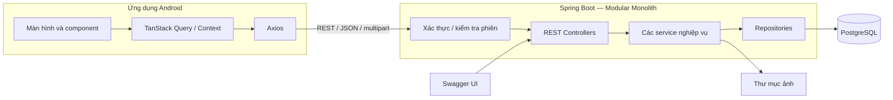
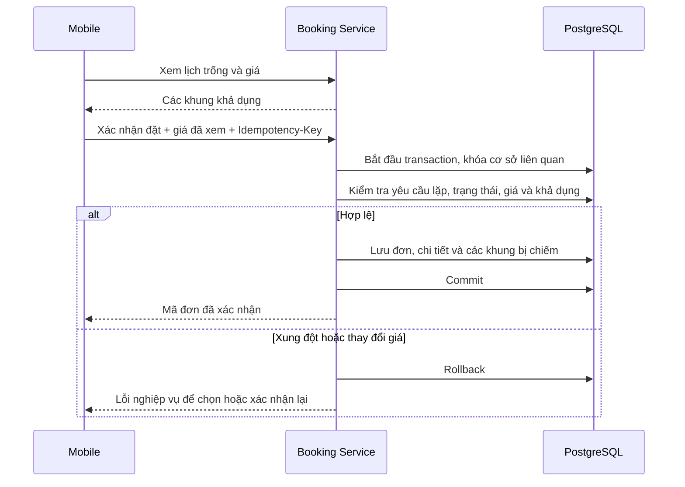

# ARCHITECTURE — Ứng dụng Android đặt sân cầu lông

- **Phiên bản:** 1.0
- **Ngày cập nhật:** 02/11/2026
- **Trạng thái:** Thiết kế đã được người dùng phê duyệt và yêu cầu lưu tài liệu.
- **Tài liệu liên quan:** [PRD.md](PRD.md), [TECH_STACK.md](TECH_STACK.md).
- **Phạm vi:** MVP M01–M15, ba vai trò Khách hàng/Chủ sân/Admin, một chủ quản lý nhiều cơ sở.
- **Lựa chọn đã chốt thêm:** Giữ đăng nhập tối đa 7 ngày; ưu tiên demo local.

Tài liệu chốt kiến trúc tổng thể, trách nhiệm module và các cơ chế quan trọng. Cấu trúc bảng chi tiết và đặc tả request/response đầy đủ sẽ được cụ thể hóa ở bước thiết kế database/API. Các cấu trúc bên dưới là thiết kế dự kiến cho source code, chưa phải những thư mục đã được khởi tạo.

## 1. Kiến trúc tổng thể

Hệ thống gồm một ứng dụng mobile, một backend Spring Boot dạng modular monolith và một PostgreSQL. Module backend cùng nằm trong một dự án, gọi nhau bằng Java service và tham gia cùng transaction khi nghiệp vụ yêu cầu.



- Mobile chỉ gọi backend, không kết nối trực tiếp PostgreSQL.
- Ba vai trò dùng cùng ứng dụng Android; màn hình và thao tác hiển thị theo quyền.
- Backend luôn kiểm tra quyền, kể cả request được gửi trực tiếp ngoài ứng dụng.
- Dữ liệu của các chủ dùng chung database/schema; phân tách bằng quan hệ sở hữu và điều kiện truy vấn.
- Backend/database chạy trên máy nhóm; mobile chạy Emulator hoặc điện thoại cùng mạng.
- Không microservices, Redis, message broker, API gateway hoặc công cụ quản lý monorepo riêng trong MVP.

## 2. Module và quy tắc phụ thuộc backend

| Module | Trách nhiệm | Đối chiếu PRD |
|---|---|---|
| identity | Tài khoản, đăng nhập, phiên, token, quyền, thông tin người dùng hiện tại | M01 |
| ownerapplication | Gửi/gửi lại hồ sơ, lịch sử xét duyệt, Admin duyệt/từ chối và tra cứu chủ sân | M11–M14 |
| venue | Cơ sở, sân, giá, giờ hoạt động, trạng thái nhận đặt và kiểm tra chủ sở hữu | M02, M07, M15 |
| booking | Lịch trống, đặt trực tuyến/trực tiếp, lịch cá nhân/quản lý, hủy, hoàn thành và bảo trì | M03–M06, M08–M10 |
| media | Kiểm tra và lưu file ảnh; cung cấp thông tin để cơ sở/sân tham chiếu ảnh | Hỗ trợ M02, M07, M15 |
| common | Định dạng lỗi, phân trang, request ID và cấu hình thời gian dùng chung | Hạ tầng |

Đặt sân và bảo trì cùng nằm trong booking vì đều quyết định khung giờ còn khả dụng hay không. Chúng phải dùng chung cơ chế chiếm khung và chống xung đột.

### 2.1. Trách nhiệm các lớp

| Lớp | Trách nhiệm |
|---|---|
| Controller | Nhận HTTP request, validation DTO, gọi service và trả HTTP response |
| Service | Kiểm tra quyền sở hữu, quy tắc nghiệp vụ, điều phối module và transaction |
| Repository | Đọc/ghi dữ liệu theo nhu cầu của module |
| Entity | Mapping dữ liệu lưu trữ và trạng thái liên quan |
| DTO | Hợp đồng vào/ra API, không trả trực tiếp entity |

### 2.2. Phụ thuộc giữa module

- Module muốn sử dụng dữ liệu hoặc thay đổi nghiệp vụ của module khác gọi service được công khai của module đó; không tùy tiện sửa repository của nhau.
- ownerapplication gọi identity để cấp quyền và venue để tạo cơ sở; các thay đổi nằm trong cùng transaction xét duyệt.
- booking sử dụng service của venue để kiểm tra sân/cơ sở, quyền sở hữu, giá và lấy khóa phục vụ thao tác ghi.
- media cung cấp chức năng lưu trữ cho nghiệp vụ cơ sở/sân; không tự quyết định quyền sửa cơ sở.
- Không tạo module admin sao chép nghiệp vụ. Controller dành cho Admin nằm trong module nghiệp vụ tương ứng.
- common không chứa quy tắc đặt sân, quyền sở hữu hoặc xét duyệt.
- Chưa tạo interface cho mọi service chỉ để có interface; chỉ tách abstraction khi có nhu cầu thay thế hoặc ranh giới rõ ràng.

## 3. Kiến trúc frontend

### 3.1. Luồng dữ liệu màn hình

**Route → Screen → Query/Mutation hook → API function → Axios → Backend.**

File route chỉ nhận tham số và mở màn hình. Logic form, tương tác lịch và gọi API được tổ chức trong feature tương ứng.

| Thành phần | Trách nhiệm |
|---|---|
| Expo Router | Điều hướng, nhóm màn hình và điều kiện truy cập |
| Screen | Ghép component, hiển thị dữ liệu, nhận tương tác |
| Component | Thành phần UI; component dùng chung không tự gọi API nghiệp vụ |
| Query/Mutation hook | Tải/lỗi/cache và cập nhật dữ liệu sau thao tác |
| API function | Gửi request, nhận DTO cho một nhóm API |
| React Hook Form | Giá trị form, validation phía giao diện, trạng thái gửi |
| Auth Context | Điều phối khôi phục phiên, trạng thái đăng nhập và thao tác phiên |
| SecureStore | Giữ refresh token qua các lần mở ứng dụng |

### 3.2. State và cache

- TanStack Query là nguồn dữ liệu server trên frontend: cơ sở, sân, lịch, đơn, hồ sơ và thông tin người dùng từ API.
- useState/useReducer quản lý ngày, khung đang chọn và hộp thoại.
- Context không sao chép các danh sách cơ sở, đơn hoặc hồ sơ đã có trong query cache.
- Form do React Hook Form quản lý; backend vẫn validation lại dữ liệu.
- Query key có tài khoản đối với dữ liệu riêng tư; có cơ sở/sân/ngày/bộ lọc khi chúng quyết định kết quả.
- Sau đặt/hủy/bảo trì, tải lại lịch và các danh sách đơn liên quan.
- Khi về màn hình lịch hoặc ứng dụng trở lại foreground, tải lại dữ liệu cần thiết. Tích hợp lifecycle React Native cho hành vi này.
- Đăng xuất/đổi tài khoản xóa cache riêng tư và nội dung màn hình liên quan.
- Không lưu bền cache nghiệp vụ để tạo luồng đặt offline ngoài PRD.

### 3.3. Navigation và vai trò

| Nhóm màn hình | Nội dung |
|---|---|
| Công khai | Danh sách/chi tiết cơ sở, sân, lịch trống |
| Tài khoản | Đăng nhập và đăng ký |
| Khách hàng | Đặt sân, lịch cá nhân, hồ sơ đăng ký chủ sân |
| Chủ sân | Danh sách cơ sở của mình, sân, giá, lịch quản lý và bảo trì |
| Admin | Hồ sơ cần duyệt và tra cứu chủ sân/cơ sở |

Chủ sân vẫn có khả năng sử dụng như khách hàng theo PRD. Khi khôi phục phiên, hiển thị trạng thái chờ trước khi quyết định nhóm màn hình. Protected routes chỉ hỗ trợ trải nghiệm; backend quyết định quyền thực sự.

## 4. Cấu trúc thư mục

Dùng một repository với mobile và backend độc lập, không cần công cụ monorepo riêng.

```text
project/
├── docs/
│   ├── PRD.md
│   ├── TECH_STACK.md
│   └── ARCHITECTURE.md
├── mobile/
│   ├── src/
│   │   ├── app/
│   │   │   ├── _layout.tsx
│   │   │   ├── (public)/
│   │   │   ├── (auth)/
│   │   │   ├── (customer)/
│   │   │   ├── (owner)/
│   │   │   └── (admin)/
│   │   ├── features/
│   │   │   ├── auth/
│   │   │   ├── owner-application/
│   │   │   ├── venues/
│   │   │   └── bookings/
│   │   ├── components/
│   │   ├── providers/
│   │   ├── lib/
│   │   ├── config/
│   │   └── theme/
│   ├── assets/
│   └── .env.example
├── backend/
│   ├── src/main/java/com/example/badminton/
│   │   ├── identity/
│   │   ├── ownerapplication/
│   │   ├── venue/
│   │   ├── booking/
│   │   ├── media/
│   │   ├── common/
│   │   └── config/
│   ├── src/main/resources/
│   │   ├── db/migration/
│   │   └── application*.yml
│   └── src/test/
└── infra/
    └── compose.yml
```

- Feature frontend có screens, components, api, hooks và types khi cần.
- components dùng chung chứa UI tái sử dụng; providers ghép Auth/Query/Theme; lib chứa HTTP client, query client và tiện ích kỹ thuật; config đọc cấu hình môi trường; theme chứa quy ước giao diện.
- Module backend có controller, service, repository, entity và dto khi cần.
- Test frontend đặt gần feature/component được kiểm tra. Test backend theo module trong src/test.
- Không tạo sẵn thư mục, abstraction hoặc interface chưa sử dụng.

## 5. Luồng REST API

### 5.1. Quy trình xử lý

1. Spring Security xác minh thông tin xác thực nếu API yêu cầu.
2. Controller nhận DTO và chạy validation đầu vào.
3. Service kiểm tra quyền sở hữu và quy tắc nghiệp vụ.
4. Repository đọc/ghi PostgreSQL trong transaction thích hợp.
5. Controller trả response DTO.
6. Frontend cập nhật cache hoặc tải lại dữ liệu liên quan.

Transaction nằm tại service thực hiện một nghiệp vụ hoàn chỉnh. Không kéo dài transaction để chờ tương tác người dùng hoặc upload mạng. Service điều phối gọi các service tham gia cùng transaction; cần lưu ý cơ chế proxy của Spring khi dùng @Transactional.

### 5.2. Nhóm endpoint

Dùng prefix **/api/v1**, JSON cho dữ liệu và multipart cho ảnh. Bảng dưới là bản đồ API; method/path đầy đủ và field DTO cho các nhóm còn lại sẽ được chốt trong tài liệu API.

| Nhóm | Endpoint hoặc nhóm endpoint | Quyền |
|---|---|---|
| Tài khoản | POST /auth/register, /auth/login, /auth/refresh, /auth/logout; GET /me | Theo từng thao tác |
| Danh mục công khai | GET /venues, /venues/{id}, /venues/{id}/courts | Công khai |
| Lịch trống | GET /courts/{id}/availability?date=... | Công khai |
| Đơn cá nhân | POST /bookings; GET /me/bookings, /me/bookings/{id} | Khách sở hữu đơn |
| Khách hủy | POST /me/bookings/{id}/cancel | Khách sở hữu đơn |
| Hồ sơ cá nhân | /me/owner-application: gửi, xem, sửa hồ sơ bị từ chối, gửi lại | Người sở hữu hồ sơ |
| Cơ sở/sân của chủ | /owner/venues và sân bên trong | Chủ sở hữu |
| Lịch quản lý | /owner/venues/{id}/bookings: xem, tạo trực tiếp, hủy, hoàn thành | Chủ sở hữu |
| Bảo trì | /owner/venues/{id}/maintenance-blocks: tạo/gỡ khóa | Chủ sở hữu |
| Xét duyệt | /admin/owner-applications, thao tác approve và reject | Admin |
| Tra cứu chủ sân | GET /admin/owners và chi tiết cơ sở của chủ | Admin |
| Ảnh | Upload tại tài nguyên cơ sở/sân đang quản lý | Chủ sở hữu |

### 5.3. Quy ước dữ liệu

- Response thành công trả DTO trực tiếp, không thêm envelope chung không cần thiết.
- Danh sách có phân trang dùng items, page, size, totalElements.
- Tạo tài nguyên trả 201; đọc/cập nhật trả 200; thao tác không có nội dung trả 204.
- Ngày lịch dùng YYYY-MM-DD, giờ dùng HH:mm; timestamp sự kiện dùng ISO 8601 UTC.
- Backend diễn giải lịch kinh doanh theo Asia/Ho_Chi_Minh.
- Tiền là VND nguyên đồng; backend tính tổng và lưu giá đã xác nhận.
- Request của chủ không được tự quyết định người sở hữu bằng ownerId.
- DTO công khai không lộ liên hệ khách đã đặt; DTO quản lý chỉ trả sau kiểm tra vai trò/sở hữu.
- Lịch trống và báo giá trước đặt là dữ liệu tham khảo, được kiểm tra lại lúc xác nhận.

## 6. Transaction, chống đặt trùng và gửi lặp

### 6.1. Luồng đặt sân



### 6.2. Cơ chế bảo vệ khả dụng

- Lưu các khung đang bị chiếm trong một cấu trúc dùng chung cho đặt sân và bảo trì.
- Unique constraint theo sân + ngày + giờ bắt đầu khung bảo vệ mỗi khung.
- Chi tiết đơn lưu riêng; hủy giải phóng khung không làm mất lịch sử đơn.
- Tất cả thao tác thay đổi lịch, giá, trạng thái sân hoặc giờ hoạt động khóa hàng cơ sở liên quan trước khi kiểm tra và ghi.
- Khóa trong transaction ngắn; các cơ sở khác nhau vẫn ghi độc lập.
- Đọc lịch không cần khóa ghi; chọn khung trên giao diện không giữ chỗ.
- Sau khi có khóa, kiểm tra lại giá, khả dụng, giờ hoạt động và trạng thái nhận đặt.
- Đơn nhiều khung thành công toàn bộ hoặc rollback toàn bộ.
- Unique constraint là lớp bảo vệ bổ sung, không thay thế validation.
- Hủy, hoàn thành, bảo trì và đổi giờ hoạt động phải giữ các quy tắc trong PRD, không vô hiệu hóa đơn đã xác nhận.

Khóa theo cơ sở là lựa chọn đơn giản cho tải nhỏ của MVP, đánh đổi việc các thao tác ghi trong cùng cơ sở phải lần lượt thực hiện. Không giữ khóa khi upload file, gọi dịch vụ mạng hoặc chờ người dùng. Chỉ tối ưu mức khóa khi đo được vấn đề thực tế.

### 6.3. Chống gửi lặp khi tạo đơn

- Mỗi ý định tạo đơn có một Idempotency-Key; mất mạng và gửi lại dùng cùng key với cùng nội dung.
- Key duy nhất theo người thực hiện; lưu key, dấu nhận diện nội dung và liên kết đơn trong cùng transaction tạo đơn.
- Gửi lại cùng nội dung trả cùng mã đơn, không tạo đơn mới.
- Cùng key nhưng nội dung khác trả 409.
- Khi người dùng thay đổi sân/giờ hoặc xác nhận báo giá mới, tạo ý định đặt mới với key mới.
- Chỉ hiển thị thành công sau xác nhận của backend. Không tự động retry mutation bằng key mới khi chưa biết kết quả cũ.

### 6.4. Xét duyệt chủ sân

- Khóa hồ sơ trước khi kiểm tra trạng thái xét duyệt.
- Cùng transaction ghi lịch sử duyệt, cấp quyền chủ sân và tạo/gán cơ sở ban đầu.
- Thất bại ở một bước phải rollback toàn bộ.
- Duyệt lặp không tạo thêm cơ sở; hai thao tác xét duyệt đồng thời chỉ có một kết quả hợp lệ.
- Cơ sở bổ sung do chủ đã duyệt tự tạo, không có vòng xét duyệt mới.

### 6.5. Persistence

- Flyway quản lý schema; Hibernate dùng validate, không dùng ddl-auto=update làm nguồn quản lý schema.
- Tắt Open Session in View để tránh truy vấn ngầm khi chuyển entity thành response.
- Dùng DTO/projection và truy vấn phù hợp; tránh trả entity trực tiếp hoặc load thừa các quan hệ.
- PostgreSQL dùng ràng buộc khóa ngoại, unique và check phù hợp; migration giữ lịch sử thay đổi.

## 7. Authentication và vòng đời phiên

### 7.1. Các thành phần

| Thành phần | Quyết định |
|---|---|
| Access token | JWT, hạn 15 phút; giữ trong bộ nhớ mobile |
| Refresh token | Chuỗi ngẫu nhiên mạnh; lưu trong Expo SecureStore |
| Phiên backend | PostgreSQL lưu hash refresh token, người dùng, hạn và trạng thái thu hồi |
| Hạn phiên | Tối đa 7 ngày từ đăng nhập; refresh không kéo dài vô hạn |
| JWT claims | Định danh người dùng và phiên, cùng thông tin kiểm tra hạn/issuer/audience |
| Quyền hiện tại | Kiểm tra từ backend/database, không chỉ tin claim quyền cũ |
| Ký token | HS256 với khóa bí mật ngẫu nhiên đủ mạnh, truyền qua cấu hình backend |
| Mật khẩu | PasswordEncoder BCrypt; không lưu rõ |

MVP dùng một refresh token cho mỗi phiên đến khi hết hạn hoặc bị thu hồi. Mỗi lần đăng nhập tạo phiên riêng; đăng xuất thu hồi phiên hiện tại. Spring Security xác minh bearer JWT; service ứng dụng phát hành token và quản lý phiên.

### 7.2. Đăng nhập

1. Backend kiểm tra email và mật khẩu BCrypt.
2. Tạo phiên, trả access token và refresh token.
3. Mobile lưu refresh token vào SecureStore, access token trong bộ nhớ.
4. Gọi GET /me để lấy thông tin và quyền hiện tại.
5. Mỗi request bảo vệ xác minh chữ ký, issuer, audience, hạn JWT, phiên còn hiệu lực và quyền hiện tại.

Quyền sở hữu được kiểm tra trên tài nguyên sau xác thực. Biết mã cơ sở/sân/đơn không có nghĩa được truy cập. Admin chỉ có các quyền đã nêu trong PRD.

### 7.3. Mở lại ứng dụng

1. Hiển thị trạng thái khôi phục phiên.
2. Đọc refresh token; nếu có, gọi refresh để lấy access token rồi gọi /me.
3. Token không hợp lệ hoặc hết hạn: xóa phiên local và chuyển về chưa đăng nhập.
4. Lỗi mạng: giữ refresh token và cho thử lại; không coi mất mạng là sai thông tin đăng nhập.

### 7.4. Xử lý 401 và cập nhật quyền

- Chỉ có một tác vụ refresh đang chạy; request khác chờ kết quả.
- Refresh thành công thì thử lại request tối đa một lần; tạo đơn giữ nguyên Idempotency-Key.
- Không refresh lặp cho login/refresh và không refresh vì 403.
- Nếu refresh bị xác nhận không hợp lệ, kết thúc phiên local và xóa cache riêng tư.
- Khi hồ sơ được duyệt, backend áp dụng quyền mới từ database. Frontend cập nhật /me khi mở lại hồ sơ hoặc ứng dụng trở về foreground.
- Không yêu cầu tài khoản mới hoặc chờ token cũ hết hạn để nhận quyền chủ sân.

### 7.5. Đăng xuất

- Backend thu hồi phiên; access token thuộc phiên đó không tiếp tục dùng được vì request bảo vệ kiểm tra trạng thái phiên.
- Mobile xóa access/refresh token, cache riêng tư và màn hình giữ dữ liệu tài khoản.
- Nếu mất mạng, chỉ xác nhận đăng xuất trên thiết bị; không tuyên bố phiên server đã được thu hồi thành công.
- Không log hoặc lưu mật khẩu trên mobile; không log token, refresh token hoặc Authorization header.

## 8. Quản lý lỗi

Dùng ProblemDetail theo RFC 9457, xử lý tập trung bằng @RestControllerAdvice. Lỗi từ security filter trả cùng định dạng qua cơ chế xử lý xác thực/phân quyền của Spring Security.

Ngoài các trường chuẩn của ProblemDetail, bổ sung code, fieldErrors khi có và requestId. Frontend dựa vào code/status để quyết định hành vi, không phân tích chuỗi message.

| HTTP | Ý nghĩa | Hành vi frontend |
|---|---|---|
| 400 | Request sai định dạng hoặc validation | Hiển thị lỗi tại trường tương ứng |
| 401 | Chưa xác thực hoặc phiên không hợp lệ | Refresh một lần nếu thích hợp |
| 403 | Không đủ vai trò | Thông báo không có quyền |
| 404 | Không tồn tại hoặc tài nguyên riêng tư ngoài quyền sở hữu | Thông báo không tìm thấy |
| 409 | Trùng lịch, giá đổi, xung đột trạng thái hoặc idempotency | Tải lại dữ liệu hoặc chờ xác nhận lại |
| 422 | Vi phạm quy tắc như quá hạn hủy | Hiển thị lý do và hướng xử lý |
| 500 | Lỗi ngoài dự kiến | Thông báo chung, kèm mã tra cứu |

- Phân biệt lỗi mạng, lỗi form và lỗi nghiệp vụ.
- Giữ nội dung form khi gửi thất bại; không báo thành công khi chưa có xác nhận.
- Chuyển lỗi constraint đã biết thành lỗi nghiệp vụ phù hợp sau khi rollback, không lộ SQL hoặc stack trace cho client.
- Backend ghi request ID và ngữ cảnh đủ để tra lỗi, không ghi mật khẩu, token hoặc toàn bộ request chứa dữ liệu nhạy cảm.

## 9. Ảnh và file

1. Chủ chọn ảnh bằng Expo ImagePicker và gửi multipart tới tài nguyên đang quản lý.
2. Backend kiểm tra xác thực, quyền sở hữu, định dạng và dung lượng.
3. Chấp nhận JPEG/PNG/WebP, tối đa 5 MB mỗi ảnh; kiểm tra nội dung file.
4. Server sinh tên lưu file; không nhận đường dẫn lưu tùy ý từ client.
5. Lưu file ngoài source code, cập nhật tham chiếu/metadata ảnh trong database.
6. URL trả về phải truy cập được từ Emulator hoặc thiết bị.

Filesystem và database không cùng transaction. Khi cập nhật database thất bại, cố gắng xóa file mới; không xóa ảnh cũ trước khi cập nhật thành công. Sự cố tiến trình có thể để lại file không còn tham chiếu, cần kiểm tra khi bảo trì dữ liệu. Demo local dùng thư mục ổn định; triển khai sau này cần lưu bền và backup cả dữ liệu lẫn ảnh.

## 10. Cấu hình môi trường và vận hành local

| Nơi | Cấu hình |
|---|---|
| Mobile | EXPO_PUBLIC_API_URL; đây là thông tin công khai |
| Backend | SPRING_PROFILES_ACTIVE, JDBC URL, tài khoản database, khóa JWT và thư mục upload |
| Local | Backend cổng 8080, PostgreSQL qua Docker Compose, thư mục upload ngoài source |
| Test | Database và thư mục ảnh riêng; dữ liệu được dựng lại có kiểm soát |
| Triển khai sau này | URL HTTPS, database và ảnh lưu bền; không bật dữ liệu demo |

- Backend có profile local, test và prod.
- Commit cấu hình mẫu; không commit mật khẩu thật hoặc khóa JWT. Thiếu cấu hình bắt buộc phải báo lỗi khi khởi động.
- Docker Compose phục vụ PostgreSQL; backend và Expo/Metro chạy trực tiếp để dễ debug.
- Máy hạn chế tài nguyên có thể cài PostgreSQL trực tiếp theo TECH_STACK.
- Trình duyệt trên máy backend dùng http://localhost:8080; Emulator truy cập backend Windows host qua http://10.0.2.2:8080; điện thoại dùng địa chỉ LAN.
- WSL/container cần kiểm tra expose/forwarding cổng. Base URL cấu hình theo môi trường, không rải cứng trong màn hình.
- Database chỉ cho backend truy cập, không cho mobile kết nối trực tiếp.
- HTTP chỉ cho môi trường local được cấu hình phù hợp; môi trường triển khai dùng HTTPS.
- Swagger bật local/test để nhóm thử API; production mặc định tắt. API vẫn kiểm tra quyền khi gọi từ Swagger.
- Kiểm tra build sớm rồi khóa bộ phiên bản theo TECH_STACK; không thay đổi version chỉ vì có bản mới.
- Bản nghiệm thu là APK chạy khi Metro đã tắt, vẫn kết nối backend local theo yêu cầu mạng của PRD.

## 11. Chiến lược testing

| Lớp | Công cụ/hướng thực hiện | Kịch bản ưu tiên |
|---|---|---|
| Frontend unit/component | Jest, jest-expo, React Native Testing Library | Chọn khung liên tiếp, form lỗi, trạng thái gửi, API lỗi không báo thành công |
| Backend unit | JUnit, Mockito, thời gian điều khiển được trong test | Tính tiền, hạn đặt, mốc hủy đúng 24 giờ, chuyển trạng thái |
| API và security | Spring test support | Khách, chủ A/B, Admin; thay mã tài nguyên để vượt quyền |
| Database integration | PostgreSQL riêng cho test | Constraint, rollback, đặt đồng thời, đặt với bảo trì, idempotency |
| Authentication | Integration và component test | Refresh đồng thời, hết 7 ngày, logout thu hồi, nhận quyền sau duyệt |
| Demo hoàn chỉnh | Emulator và APK độc lập | Đăng ký chủ, duyệt, hai cơ sở, đặt trực tuyến/trực tiếp, hủy, bảo trì |

Jest/jest-expo/React Native Testing Library là dependency phục vụ phát triển. Test thời gian dùng nguồn thời gian có thể thay thế để kiểm tra biên, không phụ thuộc thời điểm thực hiện test. Các kiểm tra transaction/concurrency phải dùng PostgreSQL, không chỉ Mockito hoặc database có hành vi SQL khác.

### 11.1. Bắt buộc trước nghiệm thu

- Hai yêu cầu cùng sân/cùng khung chỉ một thành công.
- Một khung xung đột làm toàn bộ đơn nhiều khung thất bại.
- Đặt và tạo bảo trì đồng thời không gây chồng lịch.
- Mất response rồi gửi lại cùng ý định không tạo thêm đơn.
- Giá thay đổi cần khách xác nhận lại, đơn cũ giữ giá đã chốt.
- Chủ A không đọc/sửa dữ liệu quản lý của chủ B, kể cả gọi trực tiếp backend.
- Duyệt thất bại không để lại cơ sở hoặc quyền cấp một phần; duyệt lặp không tạo trùng.
- Chủ đã duyệt tạo được nhiều cơ sở; chuyển cơ sở không lẫn dữ liệu.
- Refresh hết hạn, thu hồi hoặc lỗi mạng được phân biệt đúng.
- Đăng xuất/đổi tài khoản không lộ cache riêng tư.
- UI có tải/rỗng/lỗi, mất mạng lúc đặt không tạo xác nhận giả.
- APK chạy độc lập khi Metro đã tắt và gọi được backend demo.

### 11.2. Smoke test thiết lập môi trường

Trước triển khai hàng loạt màn hình, kiểm tra database rỗng chạy Flyway, backend mở Swagger, mobile mở trên Emulator và gọi API. Kiểm tra navigation, Paper, form, ảnh và SecureStore trên development build. Dựng lại trên máy thành viên khác và ghi phiên bản đã chạy thành công.

## 12. Rủi ro kỹ thuật

| Rủi ro | Biện pháp |
|---|---|
| Đặt và bảo trì kiểm tra riêng | Cùng booking module và cơ chế chiếm khung |
| Khóa quá lâu gây chờ | Transaction ngắn; không upload/gọi mạng trong transaction; đo trước khi tối ưu |
| Cache lịch cũ | Tải lại đúng lúc và kiểm tra lại backend |
| Token mang quyền cũ | Kiểm tra phiên/quyền hiện tại, cập nhật /me |
| Refresh/mutation gửi lặp | Một tác vụ refresh, idempotency cho tạo đơn |
| Sai timezone hoặc mốc 24 giờ | Giờ backend, timezone thống nhất, test biên |
| JPA nhiều truy vấn hoặc truy vấn ngầm | DTO/projection, kiểm tra SQL, tắt Open Session in View |
| File và database lệch nhau | Xử lý thất bại, lưu bền, kiểm tra dữ liệu và backup |
| Expo/JDK/Gradle không khớp | Kiểm tra build sớm, khóa bộ version |
| Demo local mất mạng/máy yếu | Kiểm tra LAN/Emulator, tài nguyên và chuẩn bị APK/dữ liệu trước |
| Hai cơ sở cùng tên sân gây nhầm | Tài nguyên, query key và màn hình luôn gắn đúng cơ sở |

## 13. Phạm vi và các bước thiết kế tiếp theo

- Kiến trúc phục vụ M01–M15; không thêm thanh toán, thông báo, QR, bản đồ, chat hoặc nghiệp vụ ngoài PRD.
- Không bổ sung hạ tầng phân tán.
- Tài liệu này không thay thế schema đầy đủ, đặc tả DTO/endpoint hoặc thiết kế UI chi tiết.
- Các bước tiếp theo cụ thể hóa database, API và kế hoạch triển khai trong các ranh giới đã chốt.
- Việc lưu tài liệu không cài package, tạo source frontend/backend, chạy migration hoặc thay đổi tài liệu nghiệp vụ đã duyệt.

## 14. Tài liệu chính thức tham khảo

- [Expo Router: authentication và protected routes](https://docs.expo.dev/router/advanced/authentication/).
- [TanStack Query: React Native và lifecycle](https://tanstack.com/query/latest/docs/framework/react/react-native).
- [Spring: transaction khai báo](https://docs.spring.io/spring-framework/reference/data-access/transaction/declarative/annotations.html).
- [PostgreSQL: explicit/row locking](https://www.postgresql.org/docs/current/explicit-locking.html).
- [PostgreSQL: constraints](https://www.postgresql.org/docs/current/ddl-constraints.html).
- [Spring Security: JWT resource server](https://docs.spring.io/spring-security/reference/servlet/oauth2/resource-server/jwt.html).
- [Spring MVC: ProblemDetail và xử lý lỗi](https://docs.spring.io/spring-framework/reference/web/webmvc/mvc-ann-rest-exceptions.html).
- [Expo: testing với Jest](https://docs.expo.dev/develop/unit-testing/).

Đối chiếu tài liệu đúng phiên bản khi khởi tạo dự án, theo chính sách version trong TECH_STACK.
