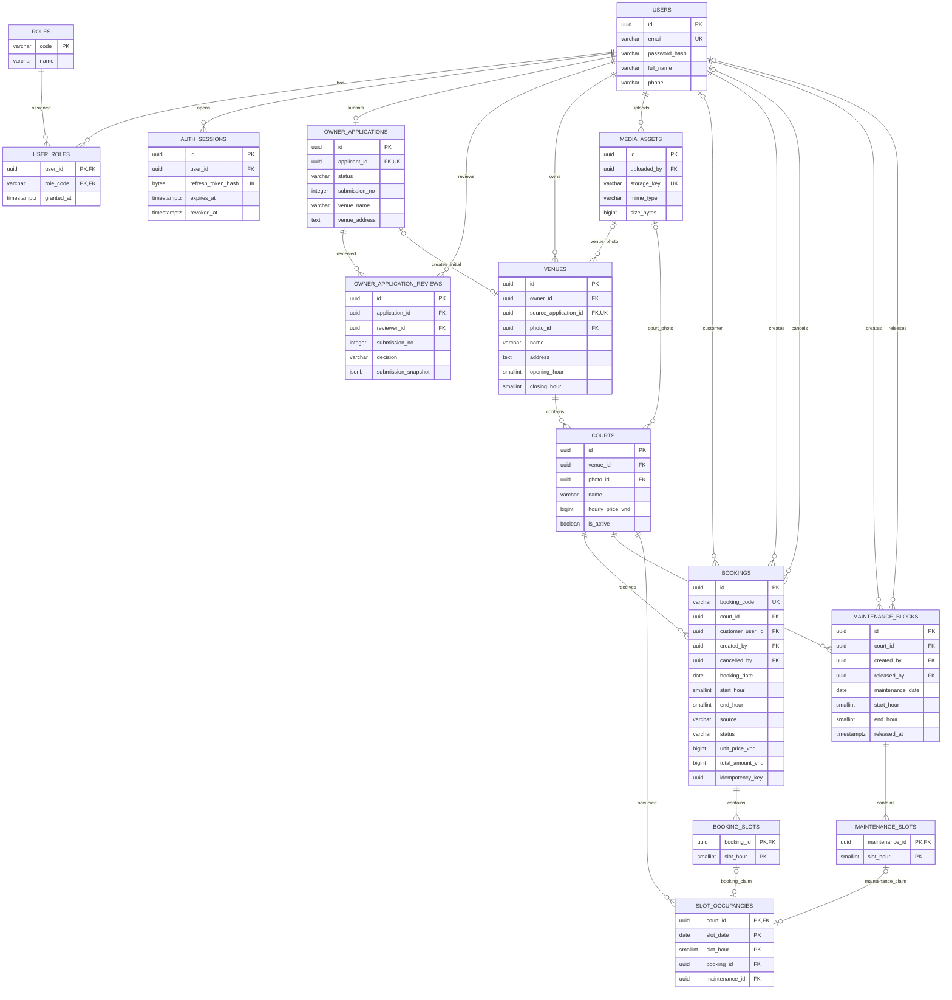

# DATABASE — Thiết kế PostgreSQL cho ứng dụng đặt sân cầu lông

- **Phiên bản:** 1.0
- **Ngày cập nhật:** 02/11/2026
- **Trạng thái:** Thiết kế đã được người dùng phê duyệt và yêu cầu lưu tài liệu.
- **Tài liệu liên quan:** [PRD.md](PRD.md), [ARCHITECTURE.md](ARCHITECTURE.md), [TECH_STACK.md](TECH_STACK.md).
- **Phạm vi:** MVP M01–M15; Khách hàng, Chủ sân và Admin; một chủ quản lý nhiều cơ sở.
- **Quyết định bổ sung đã chốt:** Khung thuê 60 phút bắt đầu tại giờ tròn; giờ mở/đóng cửa cũng theo giờ tròn.

Đây là tài liệu thiết kế để làm cơ sở cho migration và API sau này. Việc lưu tài liệu không tạo database thực tế, không viết migration SQL hoặc Java entity, không thay đổi PRD và ARCHITECTURE.

## 1. Nguyên tắc và danh sách entity

Thiết kế gồm **14 bảng**. Số bảng bao gồm tài khoản, quyền, phiên và lịch sử; không tương ứng với 14 tính năng độc lập.

| STT | Bảng | Trách nhiệm |
|---|---|---|
| 1 | users | Tài khoản và thông tin người dùng |
| 2 | roles | Danh mục ba quyền cố định |
| 3 | user_roles | Liên kết tài khoản với quyền |
| 4 | auth_sessions | Phiên đăng nhập và hash refresh token |
| 5 | owner_applications | Hồ sơ đăng ký chủ sân hiện tại |
| 6 | owner_application_reviews | Lịch sử từng lần xét duyệt và nội dung hồ sơ lúc duyệt |
| 7 | media_assets | Metadata ảnh lưu ngoài database |
| 8 | venues | Cơ sở và người sở hữu |
| 9 | courts | Sân vật lý trong cơ sở |
| 10 | bookings | Đơn đặt sân và dữ liệu giao dịch đã chốt |
| 11 | booking_slots | Chi tiết các khung giờ thuộc đơn |
| 12 | maintenance_blocks | Lịch bảo trì và thông tin gỡ khóa |
| 13 | maintenance_slots | Chi tiết các khung giờ bảo trì |
| 14 | slot_occupancies | Khung đang bị chiếm, dùng chung cho đơn và bảo trì |

Nguyên tắc chính:

- Một chủ sở hữu nhiều cơ sở; mỗi cơ sở có nhiều sân.
- Một đơn chỉ thuộc một sân, một ngày và các khung liên tiếp.
- Khách đặt trực tiếp không bắt buộc có tài khoản.
- Chi tiết lịch sử tách khỏi các khung đang bị chiếm; hủy/gỡ khóa không làm mất dữ liệu cũ.
- Đặt sân và bảo trì dùng chung cơ chế chống xung đột ở database.
- Dùng một database/schema chung theo ARCHITECTURE; quyền truy cập được backend kiểm tra theo tài khoản và quan hệ sở hữu.
- Không có bảng thanh toán, đánh giá, mã giảm giá hoặc tính năng ngoài MVP.

## 2. Quy ước dữ liệu

| Nội dung | Quy ước |
|---|---|
| Tên bảng/cột | snake_case |
| ID độc lập | uuid, backend sinh trước khi ghi |
| Khóa bảng liên kết/chi tiết | Khóa chính ghép khi phù hợp |
| Tiền | bigint, VND nguyên đồng, không dùng số thực |
| Ngày chơi | date, diễn giải theo Asia/Ho_Chi_Minh |
| Giờ bắt đầu | smallint, giá trị 0–23 |
| Giờ kết thúc | smallint, giá trị 1–24 |
| Thời điểm sự kiện | timestamptz |
| Trạng thái | varchar kèm CHECK; không dùng PostgreSQL enum |
| Giá trị bắt buộc | NOT NULL, trừ trường có cột NULL là Có |

Ví dụ: start_hour = 18 và end_hour = 20 tương ứng hai khung 18–19 và 19–20. Giá trị kết thúc 24 là cuối ngày được chọn; không cho phép đơn kéo dài sang các khung của ngày tiếp theo. Khi chuyển thành thời điểm để tính hạn hủy hoặc hoàn thành, backend kết hợp ngày, số giờ và timezone; không ép giá trị 24 vào Java LocalTime.

Các bảng users, owner_applications, venues, courts, bookings có thêm hai trường bắt buộc:

- created_at timestamptz: mặc định thời điểm tạo.
- updated_at timestamptz: backend cập nhật khi dữ liệu thay đổi.

Không giả định PostgreSQL tự cập nhật updated_at. Các bảng còn lại có thời điểm riêng được liệt kê trong từ điển dữ liệu.

timestamptz biểu diễn một thời điểm thực tế; ngày/giờ chơi được lưu riêng để thể hiện lịch kinh doanh địa phương. Cấu hình ứng dụng xử lý timestamp nhất quán với quy ước UTC cho sự kiện và Asia/Ho_Chi_Minh cho lịch.

## 3. Từ điển dữ liệu, primary key và foreign key

### 3.1. users — Tài khoản

| Thuộc tính | Kiểu | NULL | Ý nghĩa/ràng buộc |
|---|---|---|---|
| id | uuid | Không | PK |
| email | varchar(254) | Không | UNIQUE; trim và lowercase trước khi lưu |
| password_hash | varchar(255) | Không | Mật khẩu đã băm BCrypt |
| full_name | varchar(100) | Không | Không rỗng |
| phone | varchar(20) | Không | Không rỗng |
| created_at | timestamptz | Không | Thời điểm tạo |
| updated_at | timestamptz | Không | Thời điểm cập nhật |

Email có CHECK bảo đảm dữ liệu đã được chuẩn hóa và không rỗng, kết hợp UNIQUE để không có hai email chỉ khác chữ hoa/thường. Validation định dạng email thuộc backend.

Số điện thoại không bắt buộc duy nhất và không được dùng để tự liên kết đơn trực tiếp với tài khoản. Không tạo bảng owners chứa lại tên/email/điện thoại: chủ sân là tài khoản có quyền OWNER.

### 3.2. roles — Vai trò

| Thuộc tính | Kiểu | NULL | Ý nghĩa/ràng buộc |
|---|---|---|---|
| code | varchar(16) | Không | PK; CUSTOMER, OWNER hoặc ADMIN |
| name | varchar(50) | Không | Tên hiển thị |

Danh mục ba quyền được tạo bằng migration. Không có giao diện quản lý quyền động trong MVP.

### 3.3. user_roles — Quyền của tài khoản

| Thuộc tính | Kiểu | NULL | Ý nghĩa/ràng buộc |
|---|---|---|---|
| user_id | uuid | Không | PK ghép; FK → users(id) |
| role_code | varchar(16) | Không | PK ghép; FK → roles(code) |
| granted_at | timestamptz | Không | Thời điểm cấp quyền |

PK: **(user_id, role_code)**.

Đây là quan hệ N–N giữa tài khoản và vai trò. Sau khi được duyệt, người dùng giữ CUSTOMER và được thêm OWNER. Client không tự quyết định quyền khi đăng ký hoặc gửi hồ sơ.

### 3.4. auth_sessions — Phiên đăng nhập

| Thuộc tính | Kiểu | NULL | Ý nghĩa/ràng buộc |
|---|---|---|---|
| id | uuid | Không | PK; định danh phiên trong JWT |
| user_id | uuid | Không | FK → users(id) |
| refresh_token_hash | bytea | Không | UNIQUE; SHA-256 dài 32 byte |
| created_at | timestamptz | Không | Thời điểm đăng nhập |
| expires_at | timestamptz | Không | Hạn phiên |
| revoked_at | timestamptz | Có | Thời điểm thu hồi |

Ràng buộc:

- expires_at > created_at và không vượt quá 168 giờ kể từ created_at.
- revoked_at, nếu có, không trước created_at.
- Kiểm tra độ dài hash là 32 byte.
- Chỉ lưu hash refresh token; không lưu refresh token nguyên bản hoặc JWT access token.
- Phiên hợp lệ khi chưa thu hồi và chưa hết hạn; backend kiểm tra theo thời điểm request. Không dùng CHECK dựa trên thời gian hiện tại để coi phiên luôn còn hạn.

### 3.5. owner_applications — Hồ sơ đăng ký chủ sân

Mỗi tài khoản có tối đa một hồ sơ; hồ sơ bị từ chối được sửa và gửi lại.

| Thuộc tính | Kiểu | NULL | Ý nghĩa/ràng buộc |
|---|---|---|---|
| id | uuid | Không | PK |
| applicant_id | uuid | Không | UNIQUE; FK → users(id) |
| contact_name | varchar(100) | Không | Người liên hệ |
| contact_phone | varchar(20) | Không | Điện thoại liên hệ |
| venue_name | varchar(150) | Không | Cơ sở ban đầu |
| venue_address | text | Không | Địa chỉ cơ sở |
| venue_description | text | Không | Mô tả đăng ký |
| status | varchar(16) | Không | PENDING, APPROVED hoặc REJECTED |
| submission_no | integer | Không | Lần gửi, bắt đầu từ 1 |
| submitted_at | timestamptz | Không | Thời điểm gửi gần nhất |
| created_at | timestamptz | Không | Thời điểm tạo |
| updated_at | timestamptz | Không | Thời điểm cập nhật |

UNIQUE(applicant_id) mạnh hơn yêu cầu một hồ sơ đang chờ: tài khoản sử dụng lại cùng hồ sơ xuyên suốt đăng ký. submission_no phải lớn hơn 0 và tăng khi gửi lại. Các trường nội dung bắt buộc không được toàn khoảng trắng.

Email hiện tại lấy từ users, không nhập lại thành một nguồn dữ liệu độc lập. Snapshot ở lịch sử xét duyệt giữ email của lần đó khi cần tra cứu.

### 3.6. owner_application_reviews — Lịch sử xét duyệt

| Thuộc tính | Kiểu | NULL | Ý nghĩa/ràng buộc |
|---|---|---|---|
| id | uuid | Không | PK |
| application_id | uuid | Không | FK → owner_applications(id) |
| submission_no | integer | Không | Lần gửi được xét duyệt |
| reviewer_id | uuid | Không | FK → users(id); backend kiểm tra Admin |
| decision | varchar(16) | Không | APPROVED hoặc REJECTED |
| rejection_reason | text | Có | Bắt buộc khi từ chối |
| submission_snapshot | jsonb | Không | Nội dung hồ sơ tại lần xét duyệt |
| reviewed_at | timestamptz | Không | Thời điểm xét duyệt |

Ràng buộc:

- UNIQUE(application_id, submission_no).
- submission_no > 0.
- REJECTED bắt buộc lý do không rỗng; APPROVED không có lý do từ chối.
- submission_snapshot phải là JSON object. Backend lấy nội dung từ hồ sơ, không nhận snapshot tùy ý do client cung cấp.
- Backend bảo đảm số lần gửi và nội dung snapshot đúng với hồ sơ đang xét duyệt.

Snapshot gồm tên, điện thoại, email liên hệ và tên, địa chỉ, mô tả cơ sở của lần gửi đó. Khi người dùng sửa hồ sơ sau từ chối, nội dung cũ vẫn xem được cùng kết quả xét duyệt. JSONB chỉ dùng cho lịch sử; dữ liệu nghiệp vụ hiện tại vẫn nằm trong các cột rõ ràng.

### 3.7. media_assets — Metadata ảnh

| Thuộc tính | Kiểu | NULL | Ý nghĩa/ràng buộc |
|---|---|---|---|
| id | uuid | Không | PK |
| uploaded_by | uuid | Không | FK → users(id) |
| storage_key | varchar(255) | Không | UNIQUE; tên/khóa file do server sinh |
| mime_type | varchar(32) | Không | image/jpeg, image/png hoặc image/webp |
| size_bytes | bigint | Không | Lớn hơn 0, tối đa 5 MB |
| created_at | timestamptz | Không | Thời điểm lưu |

Giới hạn dung lượng được hiểu thống nhất là 5 × 1024 × 1024 byte. Backend kiểm tra nội dung file thật, không chỉ tin mime_type từ client.

File nằm ngoài database. URL được tạo từ storage_key và cấu hình backend, không lưu URL chứa IP local cố định. Storage key không được nhận như đường dẫn filesystem tùy ý từ client.

### 3.8. venues — Cơ sở cầu lông

| Thuộc tính | Kiểu | NULL | Ý nghĩa/ràng buộc |
|---|---|---|---|
| id | uuid | Không | PK |
| owner_id | uuid | Không | FK → users(id) |
| source_application_id | uuid | Có | UNIQUE; FK → owner_applications(id) |
| name | varchar(150) | Không | Tên cơ sở |
| address | text | Không | Địa chỉ |
| contact_phone | varchar(20) | Không | Số liên hệ |
| description | text | Có | Mô tả |
| amenities | text | Có | Mô tả tiện ích |
| photo_id | uuid | Có | FK → media_assets(id) |
| opening_hour | smallint | Có | Giờ mở cửa |
| closing_hour | smallint | Có | Giờ đóng cửa |
| created_at | timestamptz | Không | Thời điểm tạo |
| updated_at | timestamptz | Không | Thời điểm cập nhật |

Ràng buộc giờ:

- opening_hour và closing_hour cùng NULL hoặc cùng có giá trị.
- Khi có giá trị: 0 ≤ opening_hour < closing_hour ≤ 24.

Cơ sở ban đầu được tạo từ hồ sơ duyệt có thể chưa có giờ hoạt động. Khi đó chưa đủ điều kiện hiển thị cho khách.

source_application_id có giá trị với cơ sở ban đầu; NULL với cơ sở chủ tự tạo thêm. UNIQUE bảo vệ việc một hồ sơ không tạo hai cơ sở ban đầu. Nhiều cơ sở bổ sung được phép có source_application_id NULL.

Không lưu thêm is_published trùng với trạng thái tính được. Điều kiện hiển thị dựa vào thông tin hợp lệ, giờ hoạt động và ít nhất một sân đang nhận đặt có giá hợp lệ. Backend kiểm tra chủ sở hữu có OWNER và hồ sơ nguồn được duyệt, thuộc đúng người đăng ký.

### 3.9. courts — Sân vật lý

| Thuộc tính | Kiểu | NULL | Ý nghĩa/ràng buộc |
|---|---|---|---|
| id | uuid | Không | PK |
| venue_id | uuid | Không | FK → venues(id) |
| name | varchar(100) | Không | Tên sân trong cơ sở |
| description | text | Có | Mô tả |
| amenities | text | Có | Tiện ích riêng |
| photo_id | uuid | Có | FK → media_assets(id) |
| hourly_price_vnd | bigint | Không | Giá một giờ, lớn hơn 0 |
| is_active | boolean | Không | Đang nhận đặt, mặc định true |
| created_at | timestamptz | Không | Thời điểm tạo |
| updated_at | timestamptz | Không | Thời điểm cập nhật |

Tên sân không được rỗng và duy nhất theo venue_id + lower(trim(name)), thực thi bằng unique index theo biểu thức. Hai cơ sở được cùng có Sân số 1.

Tiện ích là mô tả văn bản trong MVP. Chưa có lọc theo danh mục tiện ích nên không tạo các bảng danh mục/liên kết riêng.

### 3.10. bookings — Đơn đặt sân

| Thuộc tính | Kiểu | NULL | Ý nghĩa/ràng buộc |
|---|---|---|---|
| id | uuid | Không | PK |
| booking_code | varchar(32) | Không | UNIQUE; mã hiển thị |
| court_id | uuid | Không | FK → courts(id) |
| booking_date | date | Không | Ngày chơi |
| start_hour | smallint | Không | Giờ bắt đầu |
| end_hour | smallint | Không | Giờ kết thúc |
| customer_user_id | uuid | Có | FK → users(id); NULL với DIRECT |
| customer_name | varchar(100) | Không | Tên khách tại lúc đặt |
| customer_phone | varchar(20) | Không | Điện thoại tại lúc đặt |
| source | varchar(16) | Không | APP hoặc DIRECT |
| created_by | uuid | Không | FK → users(id); người thực hiện |
| unit_price_vnd | bigint | Không | Giá một giờ đã chốt, lớn hơn 0 |
| total_amount_vnd | bigint | Không | Generated stored: (end_hour − start_hour) × unit_price_vnd |
| status | varchar(16) | Không | CONFIRMED, CANCELLED hoặc COMPLETED |
| idempotency_key | uuid | Không | Định danh ý định tạo đơn |
| request_hash | bytea | Không | SHA-256 của nội dung đặt, dài 32 byte |
| cancelled_by | uuid | Có | FK → users(id) |
| cancelled_at | timestamptz | Có | Thời điểm hủy |
| cancellation_reason | text | Có | Lý do hủy |
| completed_at | timestamptz | Có | Thời điểm xác nhận hoàn thành |
| created_at | timestamptz | Không | Thời điểm tạo |
| updated_at | timestamptz | Không | Thời điểm cập nhật |

Ràng buộc:

- 0 ≤ start_hour < end_hour ≤ 24.
- UNIQUE(created_by, idempotency_key).
- APP: customer_user_id bắt buộc, created_by = customer_user_id.
- DIRECT: customer_user_id phải NULL; backend kiểm tra người tạo sở hữu cơ sở.
- CANCELLED: bắt buộc cancelled_by và cancelled_at; không có completed_at.
- COMPLETED: bắt buộc completed_at; không có thông tin hủy.
- CONFIRMED: chưa có thông tin hủy/hoàn thành.
- Khi người hủy không phải khách sở hữu đơn, bắt buộc lý do không rỗng. Với DIRECT không có tài khoản khách nên chủ hủy luôn phải ghi lý do.
- Giá và tổng tiền nằm trong phạm vi bigint; backend kiểm tra phép tính trước khi ghi.
- customer_name, customer_phone và booking_code không được rỗng.

Tên, điện thoại và giá là snapshot giao dịch. Đổi thông tin tài khoản hoặc giá sân không sửa dữ liệu đã chốt. total_amount_vnd do database tính từ các cột cùng dòng, không nhận từ client. Không lưu thêm venue_id, owner_id hoặc số giờ vì đã suy ra được.

Bổ sung UNIQUE(id, court_id, booking_date) làm đích FK ghép của slot_occupancies. Đây là khóa hỗ trợ toàn vẹn tham chiếu, không thay thế PK id.

### 3.11. booking_slots — Chi tiết các khung của đơn

| Thuộc tính | Kiểu | NULL | Ý nghĩa/ràng buộc |
|---|---|---|---|
| booking_id | uuid | Không | PK ghép; FK → bookings(id) |
| slot_hour | smallint | Không | PK ghép; 0–23 |

PK: **(booking_id, slot_hour)**.

Đơn 18–20 có hai dòng giờ 18 và 19. Không lặp ngày hoặc sân, lấy từ bookings. Giữ các dòng khi hủy/hoàn thành. Backend bảo đảm tập khung đúng bằng khoảng từ start_hour đến trước end_hour, không thiếu hoặc đứt đoạn.

### 3.12. maintenance_blocks — Lịch bảo trì

| Thuộc tính | Kiểu | NULL | Ý nghĩa/ràng buộc |
|---|---|---|---|
| id | uuid | Không | PK |
| court_id | uuid | Không | FK → courts(id) |
| maintenance_date | date | Không | Ngày bảo trì |
| start_hour | smallint | Không | Bắt đầu |
| end_hour | smallint | Không | Kết thúc |
| reason | text | Không | Lý do không rỗng |
| created_by | uuid | Không | FK → users(id) |
| created_at | timestamptz | Không | Thời điểm tạo |
| released_by | uuid | Có | FK → users(id) |
| released_at | timestamptz | Có | Thời điểm gỡ khóa |

Ràng buộc:

- 0 ≤ start_hour < end_hour ≤ 24.
- released_by và released_at cùng NULL hoặc cùng có giá trị.
- released_at, nếu có, không trước created_at.
- UNIQUE(id, court_id, maintenance_date) làm đích FK ghép của slot_occupancies.

Không lưu thêm boolean is_active; trạng thái đã gỡ xác định bằng released_at. Backend kiểm tra người tạo/gỡ sở hữu cơ sở tương ứng.

### 3.13. maintenance_slots — Chi tiết khung bảo trì

| Thuộc tính | Kiểu | NULL | Ý nghĩa/ràng buộc |
|---|---|---|---|
| maintenance_id | uuid | Không | PK ghép; FK → maintenance_blocks(id) |
| slot_hour | smallint | Không | PK ghép; 0–23 |

PK: **(maintenance_id, slot_hour)**.

Giữ chi tiết sau khi gỡ bảo trì. Backend bảo đảm các khung khớp toàn bộ khoảng giờ của maintenance_blocks.

### 3.14. slot_occupancies — Khung đang bị chiếm

Đây là bảng chống xung đột dùng chung cho đặt sân và bảo trì.

| Thuộc tính | Kiểu | NULL | Ý nghĩa/ràng buộc |
|---|---|---|---|
| court_id | uuid | Không | PK ghép; FK → courts(id) |
| slot_date | date | Không | PK ghép |
| slot_hour | smallint | Không | PK ghép; 0–23 |
| booking_id | uuid | Có | Nguồn chiếm khung là đơn |
| maintenance_id | uuid | Có | Nguồn chiếm khung là bảo trì |

PK: **(court_id, slot_date, slot_hour)**.

CHECK bắt buộc đúng một trong booking_id và maintenance_id có giá trị; không cả hai và không cả hai NULL.

Các FK ghép:

| FK từ slot_occupancies | Đích tham chiếu | Bảo đảm |
|---|---|---|
| (booking_id, slot_hour) | booking_slots(booking_id, slot_hour) | Khung có trong chi tiết đơn |
| (booking_id, court_id, slot_date) | bookings(id, court_id, booking_date) | Đơn thuộc đúng sân và ngày |
| (maintenance_id, slot_hour) | maintenance_slots(maintenance_id, slot_hour) | Khung có trong chi tiết bảo trì |
| (maintenance_id, court_id, slot_date) | maintenance_blocks(id, court_id, maintenance_date) | Bảo trì thuộc đúng sân và ngày |

Hai UNIQUE hỗ trợ ở bookings và maintenance_blocks là đích tham chiếu cho FK ghép. Dùng cơ chế FK mặc định MATCH SIMPLE: nhánh có ID nguồn NULL được bỏ qua; CHECK đúng một nguồn bảo đảm luôn có một nhánh phải hợp lệ.

Nếu đơn và bảo trì chỉ dùng hai unique constraint ở hai bảng riêng, chúng vẫn có thể chiếm cùng giờ. PK chung của slot_occupancies ngăn tình huống đó. Sân/ngày ở occupancy không do client tự quyết định; backend lấy từ nguồn và FK ghép bảo vệ lại.

## 4. Quan hệ 1–1, 1–N và N–N

| Quan hệ | Loại |
|---|---|
| users ↔ roles qua user_roles | N–N |
| users → auth_sessions | 1–N |
| users → owner_applications | 1–0..1 |
| owner_applications → owner_application_reviews | 1–N |
| users → owner_application_reviews với vai trò người duyệt | 1–N |
| owner_applications → cơ sở ban đầu | 1–0..1 |
| users → venues theo owner_id | 1–N |
| venues → courts | 1–N |
| users → bookings với vai trò khách/người tạo/người hủy | 1–N, từng FK có tính bắt buộc riêng |
| courts → bookings | 1–N |
| bookings → booking_slots | 1–N |
| courts → maintenance_blocks | 1–N |
| maintenance_blocks → maintenance_slots | 1–N |
| Một khung chi tiết → occupancy hiện tại | 1–0..1 |
| media_assets → tham chiếu ảnh cơ sở/sân | 1–N; mỗi cơ sở/sân có tối đa một ảnh đại diện |

Một–không hoặc một là quan hệ tùy chọn, ví dụ người dùng chưa gửi hồ sơ hoặc khung lịch sử đã được giải phóng. UNIQUE và FK bảo vệ tối đa một; các yêu cầu tối thiểu như đơn phải có ít nhất một khung được backend tạo trong cùng transaction.

## 5. ERD bằng Mermaid

Sơ đồ thể hiện các khóa và quan hệ chính. Từ điển dữ liệu ở mục 3 là danh sách thuộc tính đầy đủ. Các constraint/FK ghép được mô tả riêng, không chỉ dựa vào đường nối trên ERD.

Hai nguồn occupancy loại trừ nhau bằng CHECK; Mermaid không thể diễn đạt đầy đủ điều kiện này. Quan hệ 1–N giữa đơn/lịch bảo trì với chi tiết là yêu cầu nghiệp vụ khi commit, không phải điều FK đơn thuần tự bảo đảm.

## 6. Constraints và giới hạn trách nhiệm

### 6.1. Database bảo vệ

- PK, FK, UNIQUE theo từ điển dữ liệu.
- Email chuẩn hóa và duy nhất; các trường bắt buộc không toàn khoảng trắng.
- Giờ hợp lệ, giá dương, hash đúng độ dài và trạng thái trong danh sách cho phép.
- Metadata hủy/hoàn thành/gỡ bảo trì nhất quán với trạng thái.
- Một hồ sơ cho mỗi người; một kết quả duyệt cho mỗi lần gửi.
- Một cơ sở ban đầu cho mỗi hồ sơ.
- Một đơn cho mỗi idempotency key của người thực hiện.
- Đúng một nguồn chiếm khung và tối đa một occupancy cho sân/ngày/giờ.
- Occupancy tham chiếu đúng sân/ngày và khung chi tiết của nguồn.

### 6.2. Backend kiểm tra trong transaction

Các quy tắc phụ thuộc bảng khác, nhiều dòng hoặc thời điểm thực hiện được xử lý ở service:

- Người quản lý có OWNER và sở hữu cơ sở; người xét duyệt có ADMIN.
- Giờ đặt ở tương lai, trong bảy ngày cho phép và trong giờ hoạt động hiện tại.
- Các khung chi tiết liên tiếp, khớp toàn bộ khoảng của đơn/bảo trì.
- Đơn CONFIRMED có đủ occupancy; đơn đã hủy không còn occupancy.
- Không chuyển trạng thái kết thúc về CONFIRMED.
- Khách hủy đúng hạn 24 giờ; chủ hủy trước giờ bắt đầu; hoàn thành sau giờ kết thúc.
- Không sửa giá và thời gian đơn đã xác nhận; đổi giờ hoạt động không vô hiệu hóa lịch đã có.
- Không sửa hồ sơ đang chờ/đã duyệt; gửi lại tăng submission_no, giữ lịch sử cũ.
- Xét duyệt cập nhật hồ sơ, lịch sử, quyền và cơ sở đồng thời.
- source_application_id thuộc hồ sơ được duyệt của đúng chủ.
- Ảnh được tham chiếu thuộc quyền sử dụng của người quản lý.

Không dùng CHECK để truy vấn bảng khác hoặc bảo vệ quy tắc thời gian biến động. Những quy tắc trên được kiểm chứng bằng integration test, không tuyên bố chỉ cần constraint là đủ. Chưa thêm trigger để thay thế service nghiệp vụ.

### 6.3. Null trong CHECK

Khi viết migration, các điều kiện nullable phải xử lý rõ IS NULL/IS NOT NULL hoặc IS DISTINCT FROM khi thích hợp. Không dựa vào so sánh có thể trả UNKNOWN để bảo vệ điều kiện bắt buộc. NOT NULL kết hợp CHECK cho các cột cần giá trị.

## 7. Indexes đề xuất

PK và UNIQUE đã có index hỗ trợ, không tạo lại cùng chức năng. PostgreSQL không tự tạo index cho mọi cột FK.

| Bảng | Index bổ sung | Mục đích |
|---|---|---|
| user_roles | (role_code, user_id) | Tra cứu chủ sân theo quyền |
| auth_sessions | (user_id) | Tra cứu phiên của tài khoản |
| owner_applications | (submitted_at, id) WHERE status = PENDING | Danh sách hồ sơ chờ duyệt |
| venues | (owner_id, created_at, id) | Danh sách cơ sở của chủ |
| courts | (venue_id, is_active) | Sân trong cơ sở và sân nhận đặt |
| bookings | (customer_user_id, booking_date DESC, start_hour DESC, id) WHERE customer_user_id IS NOT NULL | Lịch cá nhân |
| bookings | (court_id, booking_date, start_hour, id) | Lịch quản lý theo sân/ngày |
| maintenance_blocks | (court_id, maintenance_date, start_hour) | Tra cứu bảo trì |

Unique index courts theo venue_id + lower(trim(name)) phục vụ kiểm tra tên sân. UNIQUE trên email, booking_code, refresh_token_hash, applicant_id, lần xét duyệt, nguồn cơ sở và idempotency đã hỗ trợ tra cứu tương ứng.

PK slot_occupancies có thứ tự court_id, slot_date, slot_hour phục vụ lịch một sân trong một ngày. Không cần thêm index riêng trùng chức năng. PK của booking_slots và maintenance_slots hỗ trợ lấy chi tiết theo nguồn.

Partial index chỉ dùng điều kiện ổn định như trạng thái, không dùng điều kiện thay đổi theo hiện tại kiểu còn hạn lúc này. Không tạo GIN cho snapshot JSONB vì MVP không truy vấn nội dung lịch sử theo trường JSON. Chỉ mở rộng index sau khi xem truy vấn thực tế và kế hoạch thực thi.

## 8. Kiểm tra chuẩn hóa

Mục tiêu là 3NF cho dữ liệu nghiệp vụ hiện tại, với một số bản lưu có chủ đích:

- Quyền tách khỏi users qua user_roles, không lưu chuỗi CUSTOMER,OWNER trong một cột.
- Không lặp thông tin chủ trong từng sân hoặc đơn; suy ra qua venues.
- bookings không lưu venue_id hoặc owner_id vì có court_id.
- Danh sách giờ là các dòng chi tiết, không là chuỗi hoặc JSON.
- Không lưu số giờ riêng, vì tính được từ start_hour/end_hour.
- Không tạo sẵn mọi khung trống cho mọi ngày; sinh lịch từ giờ hoạt động rồi trừ occupancy.

| Ngoại lệ có chủ đích | Lý do |
|---|---|
| Tên/điện thoại khách và đơn giá trong đơn | Snapshot giao dịch, độc lập thông tin hiện tại |
| submission_snapshot JSONB | Giữ nội dung của từng lần xét duyệt khi hồ sơ hiện tại bị sửa |
| total_amount_vnd generated stored | Dữ liệu dẫn xuất do database tự tính nhất quán |
| Sân/ngày trong slot_occupancies | Cần khóa chống trùng chung cho hai nguồn; FK ghép bảo vệ nhất quán |

Các snapshot không được đồng bộ ngược khi thông tin hiện tại thay đổi. Tiện ích dạng text là mô tả hiển thị, không phải danh mục có thể truy vấn từng phần. Nếu sau này bổ sung lọc theo tiện ích, cần xem xét danh mục và bảng liên kết N–N riêng.

## 9. Transaction và cập nhật khả dụng

### 9.1. Đặt sân

1. Bắt đầu transaction và khóa hàng cơ sở liên quan theo ARCHITECTURE.
2. Kiểm tra quyền, ngày/giờ, giá, idempotency và khả dụng.
3. Tạo bookings, toàn bộ booking_slots và slot_occupancies.
4. Commit; lỗi một khung phải rollback toàn bộ.

Idempotency key duy nhất theo created_by. request_hash được backend tính từ nội dung nghiệp vụ đã chuẩn hóa; không gồm access token hoặc dữ liệu thay đổi chỉ vì retry. Cùng key/cùng nội dung trả cùng mã đơn; khác nội dung trả xung đột. Ý định mới hoặc xác nhận báo giá mới dùng key mới.

### 9.2. Hủy đơn

1. Khóa cơ sở, kiểm tra người yêu cầu và chính sách hủy.
2. Đổi status, ghi người/thời điểm/lý do hủy phù hợp.
3. Xóa occupancy của đơn; giữ bookings và booking_slots.
4. Commit đồng thời.

### 9.3. Hoàn thành

Sau giờ kết thúc, cập nhật COMPLETED và completed_at, giải phóng occupancy còn lại; giữ lịch sử. Đơn CONFIRMED đã qua giờ chưa được chủ xác nhận không tự chuyển trạng thái. Occupancy cũ không ảnh hưởng khả dụng của ngày khác.

### 9.4. Bảo trì

Tạo maintenance_blocks, maintenance_slots và occupancy trong cùng transaction sau khi khóa cơ sở và kiểm tra xung đột. Gỡ bảo trì ghi released_by/released_at, xóa occupancy, giữ chi tiết. Gỡ khóa không khôi phục đơn đã hủy.

### 9.5. Xét duyệt chủ sân

Khóa hồ sơ, kiểm tra trạng thái/lần gửi, ghi review và snapshot, cập nhật trạng thái hồ sơ, cấp OWNER và tạo cơ sở nguồn trong cùng transaction. Lỗi một bước phải rollback toàn bộ. Khóa hồ sơ kết hợp UNIQUE của review và source_application_id bảo vệ duyệt lặp.

Khóa cơ sở giữ các thao tác ghi trong cùng cơ sở nhất quán; PK occupancy là lớp chống trùng cuối cùng. Các cơ sở khác nhau vẫn xử lý độc lập. Không giữ transaction khi chờ tương tác người dùng hoặc upload mạng.

## 10. Chính sách xóa và lưu lịch sử

- FK mặc định NO ACTION; không cascade xóa tài khoản, cơ sở, sân, đơn hoặc lịch sử.
- Ngừng nhận đặt bằng courts.is_active, không xóa sân đã có đơn.
- Hủy/gỡ khóa là đổi trạng thái và giải phóng occupancy, không xóa lịch sử.
- Không có chức năng xóa tài khoản/cơ sở trong MVP.
- Không xóa media_assets còn được tham chiếu.
- Không dùng deleted_at chung cho mọi bảng khi chưa có nghiệp vụ cần thiết.
- Dữ liệu test/demo phải tách môi trường vận hành; thao tác dựng lại dữ liệu chỉ dành cho môi trường tương ứng.

## 11. Kịch bản kiểm chứng khi triển khai

1. Một chủ có hai cơ sở, cả hai có Sân số 1 mà không vi phạm UNIQUE.
2. Hai yêu cầu cùng sân/ngày/giờ chỉ một thành công.
3. Đặt và bảo trì đồng thời chỉ một nghiệp vụ chiếm được khung.
4. Một khung xung đột khiến cả đơn nhiều giờ rollback, không còn dữ liệu tạo một phần.
5. Hủy/gỡ bảo trì giải phóng chỗ, lịch sử vẫn còn.
6. Occupancy sai sân/ngày hoặc không có khung chi tiết bị FK từ chối.
7. Occupancy có cả hai nguồn hoặc không có nguồn bị CHECK từ chối.
8. Đơn DIRECT có tên/điện thoại nhưng không cần tài khoản khách và không tự liên kết bằng số điện thoại.
9. Cùng idempotency key không tạo thêm đơn; nội dung khác bị từ chối.
10. Đổi giá sân không đổi giá và tổng tiền đơn cũ.
11. Hồ sơ bị từ chối rồi sửa/gửi lại vẫn giữ nội dung và kết quả cũ.
12. Duyệt lặp hoặc lỗi giữa chừng không tạo hai cơ sở hoặc cấp quyền một phần.
13. Refresh token chỉ lưu hash; phiên bị thu hồi hoặc quá bảy ngày không hợp lệ.
14. Chủ A không truy cập dữ liệu quản lý của chủ B qua API.
15. Kiểm tra biên giờ, gồm 23–24, ngày cuối được đặt và mốc hủy đúng 24 giờ.

Các kịch bản này là yêu cầu kiểm chứng cho giai đoạn triển khai, chưa phải kết quả test database thực tế. Kiểm tra constraint/transaction/concurrency phải chạy trên PostgreSQL riêng cho test.

## 12. Phạm vi đã chốt và tài liệu tham khảo

Thiết kế chốt 14 bảng, thuộc tính, khóa, quan hệ, quy tắc giờ tròn, cơ chế occupancy dùng chung, lịch sử, indexes và ranh giới giữa constraint với service validation. Không thêm bảng cho tính năng ngoài MVP.

Migration sẽ do Flyway quản lý theo TECH_STACK. Java entity và đặc tả API được xây dựng từ thiết kế này ở các bước tiếp theo; không được tự bỏ các FK ghép hoặc ràng buộc nghiệp vụ khi mapping ORM.

Tham khảo chính thức:

- [PostgreSQL: constraints, foreign key và giới hạn CHECK](https://www.postgresql.org/docs/current/ddl-constraints.html).
- [PostgreSQL: partial indexes](https://www.postgresql.org/docs/current/indexes-partial.html).
- [PostgreSQL: kiểu ngày giờ](https://www.postgresql.org/docs/current/datatype-datetime.html).
- [PostgreSQL: row locking](https://www.postgresql.org/docs/current/explicit-locking.html).
- [PostgreSQL: generated columns](https://www.postgresql.org/docs/current/ddl-generated-columns.html).

Các trang current có thể thay đổi; đối chiếu phiên bản PostgreSQL được khóa khi triển khai.
