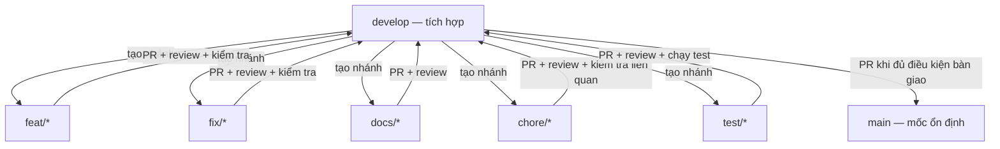
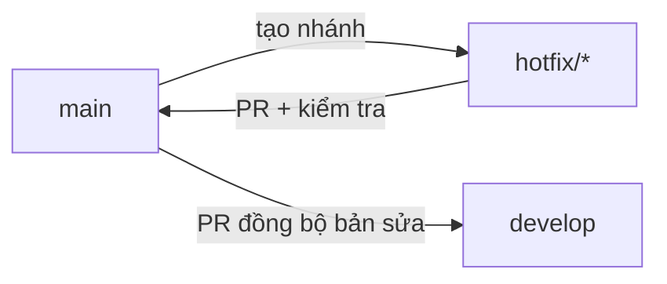
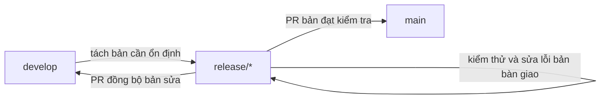

# GIT — Quy trình quản lý mã nguồn và phối hợp nhóm

- **Phiên bản:** 1.0 — 10/11/2026.
- **Trạng thái:** Đề xuất quy trình để nhóm thống nhất; không thay thế các tài liệu nghiệp vụ và kỹ thuật đã duyệt.
- **Đối tượng:** Nhóm bốn thành viên phát triển ứng dụng đặt sân cầu lông.
- **Phạm vi:** Nhánh Git, commit, review, tích hợp, xử lý tình huống và phân công công việc.
- **Nguồn đối chiếu:** [PRD.md](PRD.md), [TECH_STACK.md](TECH_STACK.md), [ARCHITECTURE.md](ARCHITECTURE.md), [DATABASE.md](DATABASE.md), [API_SPEC.md](API_SPEC.md), [DESIGN.md](DESIGN.md), [ROADMAP.md](ROADMAP.md).

Các tài liệu nguồn chưa quy định mô hình nhánh Git cụ thể. Tên nhánh, cách merge và phân công bốn người trong tài liệu này là đề xuất quản lý công việc, không phải quyết định nghiệp vụ đã được phê duyệt. Ví dụ task lấy từ roadmap; không xác nhận task đã bắt đầu hoặc hoàn thành.

Không bổ sung nghiệp vụ, API, schema, công nghệ hoặc hạ tầng triển khai ngoài tài liệu nguồn. Khi tài liệu chưa rõ hoặc mâu thuẫn, nhóm phải thống nhất trước khi triển khai lệch hợp đồng.

## 1. Nguyên tắc và trách nhiệm

### 1.1. Nguyên tắc chung

1. Dùng một repository cho `mobile/`, `backend/`, `infra/` và `docs/`, theo ARCHITECTURE.
2. Chia nhánh theo công việc, không chia nhánh lâu dài theo từng người.
3. Mỗi task có một người chủ trì và người khác review, theo ROADMAP.
4. Mỗi người chỉ giữ một task đang làm; tích hợp sớm bằng thay đổi nhỏ.
5. Quy trình thông thường không push trực tiếp vào `main` hoặc `develop`; dùng Pull Request, viết tắt là PR.
6. Push hoặc merge không tự động làm task DONE. Phải đạt Definition of Done và tiêu chí riêng trong roadmap.
7. Không tự đổi API/schema/nghiệp vụ để giải quyết vướng mắc cục bộ.
8. Không force push, viết lại lịch sử hoặc xóa thay đổi của người khác như cách xử lý lỗi thông thường.

### 1.2. Ai chịu trách nhiệm gì?

| Vai trò | Trách nhiệm |
|---|---|
| Người chủ trì task | Chốt phạm vi, triển khai, kiểm tra, cập nhật PR và thông báo ảnh hưởng |
| Người review | Kiểm tra tính đúng đắn, hợp đồng, kiểm thử và tác động tới phần đang có |
| Người phụ trách Git/tích hợp | Giữ quy trình nhất quán, điều phối thay đổi dùng chung, kiểm soát đợt đưa code lên `main` |
| Cả nhóm | Báo phụ thuộc, tránh sửa chồng, cập nhật hướng dẫn và không che giấu phần chưa kiểm tra |

Người phụ trách Git có thể là một trong bốn thành viên, không phải một vị trí thứ năm và không nhất thiết tự merge tất cả PR. Vai trò này không liên quan tới quyền ADMIN của ứng dụng.

## 2. Các loại nhánh

### 2.1. Nhánh lâu dài

| Nhánh | Mục đích | Nhận thay đổi thông thường từ |
|---|---|---|
| `main` | Mốc code ổn định, đã kiểm tra cho đợt bàn giao/phát hành tương ứng | PR từ `develop` |
| `develop` | Tích hợp công việc của nhóm trước khi đưa lên `main` | PR từ các nhánh task |

`develop` không phải nơi đẩy code hỏng tùy ý. Phần việc được merge phải kiểm tra được và không làm hỏng các kiểm tra đang có. `main` có thể là mốc ổn định của một giai đoạn; không mặc định mọi commit trên đó là MVP hoàn chỉnh.

### 2.2. Nhánh công việc

| Tiền tố | Mục đích | Ví dụ | Tạo từ / PR về |
|---|---|---|---|
| `feat/*` | Triển khai tính năng | `feat/T03.03-login-api` | `develop` / `develop` |
| `fix/*` | Sửa lỗi thông thường | `fix/login-error-handling` | `develop` / `develop` |
| `docs/*` | Tài liệu độc lập | `docs/design-update` | `develop` / `develop` |
| `chore/*` | Cấu hình, công cụ, bảo trì dự án | `chore/T01.07-test-harness` | `develop` / `develop` |
| `test/*` | Công việc chuyên về kiểm thử | `test/T05.12-booking-concurrency` | `develop` / `develop` |

Quy tắc đặt tên:

- Dùng tiếng Anh, ngắn gọn, không có khoảng trắng; nối các từ bằng `-`.
- Nếu công việc có mã task trong roadmap thì đưa mã đó vào tên.
- Một nhánh có một mục tiêu; không gom các việc không liên quan.
- `feat/T03.03-login-api` là tên đầy đủ của một nhánh. Không cần tạo nhánh `feat` trước.
- Test và tài liệu đi cùng một tính năng có thể nằm ngay trong nhánh tính năng; không bắt buộc tách riêng.

### 2.3. Nhánh ngoại lệ, chỉ dùng khi cần

| Nhánh | Khi dùng | Tạo từ | Tích hợp về |
|---|---|---|---|
| `hotfix/*` | Sửa gấp lỗi của bản ổn định mà không mang theo tính năng chưa sẵn sàng | `main` | `main`, sau đó đồng bộ bản sửa vào `develop` |
| `release/*` | Ổn định riêng một bản bàn giao trong khi `develop` vẫn tiếp tục nhận tính năng | `develop` | `main` và đồng bộ các bản sửa vào `develop` |

Với quy mô hiện tại, chưa bắt buộc dùng `release/*`. Không tạo sẵn tất cả loại nhánh nếu chưa có công việc tương ứng.

Không đề xuất nhánh lâu dài `frontend`, `backend` hoặc tên từng thành viên. Không cần nhánh `prod` hay `staging` chỉ để giống dự án công ty. Các profile backend `local`, `test`, `prod` trong ARCHITECTURE là cấu hình môi trường, không bắt buộc có nhánh Git cùng tên. MVP ưu tiên demo local, không tự suy diễn rằng đã có hệ thống triển khai production.

## 3. Sơ đồ các luồng nhánh

Các sơ đồ bao phủ những loại nhánh trong quy trình đề xuất này, không yêu cầu tạo mọi nhánh. Mũi tên ghi rõ thao tác tạo nhánh hoặc tích hợp; Git không lưu một cấu trúc nhánh cha–con cố định như thư mục.

### 3.1. Luồng thông thường



### 3.2. Hai task chạy song song

```text
Thời gian ────────────────────────────────────────────►

develop   D0────────────────D1──────────────────────D2
           │                ▲ │                     ▲
           ├── task A: A1─A2─┘ │                     │
           │                  │                     │
           └── task B: B1─B2──U────────B3────────────┘
                              ▲
                              └── nhận develop tại D1

D1: task A đã được review và merge.
U: task B nhận thay đổi mới từ develop rồi kiểm tra lại.
D2: task B được review và merge.
```

Sơ đồ thể hiện thứ tự thao tác, không phải toàn bộ commit graph. Hai task có thể bắt đầu từ cùng một phiên bản `develop`. Task vào sau cần kiểm tra tương thích với những thay đổi đã được tích hợp trước.

### 3.3. Sửa gấp bản ổn định



Không merge toàn bộ `develop` lên `main` chỉ để lấy một bản sửa gấp, vì có thể kéo theo tính năng chưa sẵn sàng.

### 3.4. Ổn định release nếu nhóm quyết định sử dụng



Không phát triển tính năng mới trên `release/*`. Nếu `main` có bản sửa mới trong thời gian này, người phụ trách cần điều phối đồng bộ, không để bản release bỏ mất bản sửa đó.

## 4. Bộ lệnh tối thiểu và cách hiểu

Các lệnh dưới đây là lệnh Git thông thường, không phải alias hoặc công cụ tự tạo. Chạy tại thư mục repository. Nội dung trong `<...>` là chỗ phải thay bằng giá trị thật, không nhập nguyên dấu `< >`.

### 4.1. Lệnh dùng hằng ngày

| Lệnh | Ý nghĩa |
|---|---|
| `git status` | Xem nhánh hiện tại, thay đổi và trạng thái merge |
| `git diff` | Xem thay đổi chưa stage của file đã được Git theo dõi |
| `git add <duong-dan>` | Chọn thay đổi để đưa vào commit |
| `git diff --cached` | Xem nội dung đã stage trước khi commit |
| `git commit -m "noi dung"` | Lưu một mốc thay đổi ở local |
| `git checkout <nhanh>` | Chuyển sang nhánh đã có |
| `git checkout -b <nhanh>` | Tạo nhánh từ vị trí hiện tại và chuyển sang |
| `git pull --ff-only origin <nhanh>` | Cập nhật từ remote, dừng nếu không thể fast-forward |
| `git push -u origin <nhanh>` | Push và thiết lập upstream cho nhánh |
| `git push` | Push tiếp khi đã có upstream và cấu hình push phù hợp |
| `git merge <nhanh>` | Tích hợp nhánh chỉ định vào nhánh đang đứng |
| `git merge --no-ff <nhanh>` | Giữ merge commit khi có thay đổi cần merge, kể cả khi có thể fast-forward |

`origin` là tên remote thường có sau khi clone. Nếu repository dùng tên remote khác, thay cho đúng. File mới chưa được theo dõi không hiện trong `git diff` thông thường; xem `git status`, mở file để kiểm tra và xem lại sau khi stage.

### 4.2. Lệnh chỉ dùng cho tình huống cụ thể

| Lệnh | Khi cần |
|---|---|
| `git clone <URL>` | Lấy repository lần đầu |
| `git fetch origin` | Cập nhật tham chiếu remote, ví dụ trước khi checkout nhánh người khác vừa tạo |
| `git pull --no-rebase origin <nhanh>` | Tích hợp bằng merge khi nhánh task chung có commit mới ở cả local và remote |
| `git merge --abort` | Hủy một merge đang dở khi chưa thể xử lý tiếp |

Không cần dùng `rebase`, `stash`, `cherry-pick` hoặc các lệnh xóa lịch sử trong luồng cơ bản này. Tình huống ngoài hướng dẫn cần được xem xét theo trạng thái thực tế, không xử lý bằng một chuỗi lệnh nguy hiểm áp dụng cho mọi trường hợp.

### 4.3. Ba điểm dễ nhầm

**Pull không chuyển nhánh.** `git pull origin develop` lấy thay đổi từ remote `develop` vào nhánh đang đứng. Muốn cập nhật local `develop`, phải checkout về đó trước. `git pull develop` thường không đúng vì Git hiểu `develop` ở vị trí tên remote.

**Commit khác push.** Commit lưu lịch sử ở máy. Push gửi commit lên remote. Người khác chưa có thay đổi chỉ vì bạn đã commit.

**Merge nhận vào nhánh đang đứng.** Ví dụ:

```bash
git checkout feat/T03.03-login-api
git merge develop
```

Lệnh trên nhận `develop` vào nhánh tính năng, không đưa tính năng lên `develop`. `merge develop` dùng bản `develop` ở local; vì vậy cần cập nhật nó trước.

### 4.4. Phân biệt merge và merge --no-ff

- Nhận cập nhật từ `develop` vào nhánh task: dùng `git merge develop`.
- Kết thúc task: đề xuất PR dùng **Create a merge commit**, giữ ranh giới tích hợp tương tự `merge --no-ff`.
- `--no-ff` không tránh conflict và không thay thế review/test.
- Nếu nhánh đã được tích hợp đầy đủ, `--no-ff` không ép tạo một merge commit rỗng.

Ví dụ minh họa cú pháp, không phải hướng dẫn bỏ qua PR:

```bash
git checkout develop
git merge --no-ff feat/T03.03-login-api -m "Merge login API task"
```

Trong quy trình nhóm, việc đưa task vào nhánh dùng chung thực hiện qua PR sau review. Không thực hiện lại merge local để push thẳng vào nhánh được bảo vệ. Nếu nhóm chọn chế độ merge PR khác, cần thống nhất trước thay vì mỗi PR dùng một cách tùy ý.

## 5. Tình huống 1 — Tham gia dự án và nhận task

### 5.1. Thành viên mới chưa có repository

Sau khi được cấp quyền truy cập:

```bash
git clone <URL_REPOSITORY>
cd <THU_MUC_DU_AN>
git checkout develop
git pull --ff-only origin develop
```

Ví dụ này giả định remote đã có `develop`. Thiết lập môi trường theo hướng dẫn hiện có; không tự đoán phiên bản hoặc đánh dấu môi trường đã chạy chỉ vì clone thành công.

### 5.2. Nhận task độc lập mới

Trước khi tạo nhánh, chốt mã task, tiêu chí hoàn thành, phụ thuộc, chủ trì, reviewer và file dùng chung có thể bị ảnh hưởng. Ví dụ T03.03 chỉ bắt đầu theo phụ thuộc của MS03 và T03.02 trong ROADMAP.

```bash
git status
git checkout develop
git pull --ff-only origin develop
git checkout -b feat/T03.03-login-api
```

Trước khi checkout/pull, xử lý các thay đổi của công việc cũ. Không cần checkout về `main` trước và không tạo nhánh mới từ nhánh task cũ theo thói quen.

### 5.3. Task mới phụ thuộc task chưa merge

Ưu tiên:

1. Chờ phần nền cần thiết được review và merge vào `develop`; hoặc
2. Chia phần nền thành thay đổi nhỏ, hoàn chỉnh, kiểm tra được để merge trước.

Chỉ tạo nhánh từ nhánh task khác khi nhóm chủ động chấp nhận phụ thuộc. PR phải ghi rõ rằng nhánh mới chứa cả thay đổi nền; không vô tình merge phần nền chưa duyệt qua PR của task sau. Khi phần nền vào `develop`, cập nhật lại nhánh phụ thuộc và kiểm tra diff PR.

### 5.4. Chưa có task đủ điều kiện bắt đầu

Ghi BLOCKED và nêu phụ thuộc. Có thể hỗ trợ review, kiểm thử hoặc chuẩn bị UI/fixture đúng DTO theo ROADMAP. Không coi chuẩn bị bằng fixture là đã tích hợp API thật và không báo DONE trước khi đạt phụ thuộc, tiêu chí.

## 6. Tình huống 2 — Đang làm, hoàn thành và review task

### 6.1. Lưu công việc trong ngày

```bash
git status
git diff
git add <CAC_FILE_CUA_TASK>
git diff --cached
git commit -m "feat: implement login API"
git push -u origin feat/T03.03-login-api
```

Những lần push tiếp theo khi đã có upstream dùng `git push`. Chọn đúng file của task, tránh stage toàn bộ một cách máy móc. File mới cần mở kiểm tra vì chưa hiện trong `git diff` trước khi stage.

Có thể commit/push phần việc chưa hoàn tất để lưu và phối hợp, nhưng chưa đủ điều kiện merge. Commit nên mô tả thay đổi thực tế, ví dụ `feat:`, `fix:`, `docs:`, `test:`, `chore:`; tránh các tên `update`, `done`, `final` không nói rõ nội dung.

### 6.2. Develop có cập nhật trong lúc đang làm

Sau khi commit phần việc liên quan trên nhánh task và bảo đảm trạng thái làm việc sạch:

```bash
git checkout develop
git pull --ff-only origin develop
git checkout feat/T03.03-login-api
git merge develop
```

Giải quyết conflict nếu có, chạy lại kiểm tra liên quan rồi push nhánh task. Không cần xóa hoặc tạo lại nhánh. Nếu lệnh merge mở trình soạn thảo thông điệp commit, lưu và đóng để hoàn tất, hoặc xử lý theo thông báo Git nếu có conflict.

### 6.3. Làm xong và mở PR

Chọn đúng chiều:

```text
base:    develop
compare: feat/T03.03-login-api

Nghĩa là: nhánh task → develop
```

Mẫu nội dung PR:

```markdown
## Task
T03.03 — API login

## Thay đổi
- Nội dung đã triển khai.

## Kiểm tra
- Lệnh hoặc kiểm tra thực tế đã chạy và kết quả.
- Phần chưa kiểm tra và lý do.

## Ảnh hưởng và phụ thuộc
- API/schema/file dùng chung bị tác động.
- Task nền hoặc vấn đề còn lại.

## Ảnh minh họa
- Bổ sung khi thay đổi giao diện.
```

Không ghi test pass nếu chưa chạy. Task chỉ kiểm tra một phần phải ghi đúng mức độ; không lấy việc merge PR làm bằng chứng toàn bộ milestone hoàn thành.

### 6.4. Reviewer yêu cầu sửa

Tiếp tục trên chính nhánh của PR, commit và push. PR được cập nhật theo nhánh đó; không tạo PR mới cho từng lần sửa. Yêu cầu review lại nếu nội dung thay đổi đáng kể sau lần review trước.

### 6.5. PR đã merge

```bash
git checkout develop
git pull --ff-only origin develop
```

Task tiếp theo tạo nhánh mới từ `develop` đã cập nhật. Không tiếp tục dùng nhánh task đã merge. Có thể xóa nhánh task trên giao diện remote sau khi đã merge và không còn ai phụ thuộc; không xóa nhánh đang phục vụ bàn giao hoặc nhánh chung mà chưa báo người còn lại.

## 7. Tình huống 3 — Hai người cùng làm một task

### 7.1. Có thể tách phần việc độc lập — ưu tiên

Ví dụ hai người phối hợp T03.08: một người làm form login, người kia hỗ trợ lưu token và kiểm thử theo đúng phạm vi task. Phải thống nhất trách nhiệm vì có thể cùng tác động feature auth và `AuthProvider`.

```text
develop ──┬── nhánh phần việc A ── PR ──► develop
          └── nhánh phần việc B ── PR ──► develop
```

- Mỗi nhánh có một người chủ trì.
- Nếu B phụ thuộc A, ghi rõ và thống nhất thứ tự merge.
- Chỉ merge riêng khi phần việc hoàn chỉnh ở mức đã cam kết, kiểm tra được và không làm hỏng dự án.
- Các phần việc là cách tổ chức thực hiện, không tự thêm mã task hoặc thay tiêu chí roadmap.
- Hai PR đã merge chưa có nghĩa task tổng đã DONE nếu chưa tích hợp và kiểm tra đầy đủ.

Nếu không tách thành các thay đổi độc lập hợp lý, dùng một nhánh chung hoặc cùng làm theo mục 7.3.

### 7.2. Hai người dùng chung một nhánh

Người thứ nhất tạo và push:

```bash
git checkout develop
git pull --ff-only origin develop
git checkout -b feat/T03.08-login-mobile
git push -u origin feat/T03.08-login-mobile
```

Người thứ hai, nếu chưa có nhánh này ở local:

```bash
git fetch origin
git checkout -b feat/T03.08-login-mobile origin/feat/T03.08-login-mobile
```

Nếu đã có nhánh local, chỉ checkout nhánh đó rồi cập nhật, không dùng `-b` lần nữa. Trước phiên làm việc, khi trạng thái sạch:

```bash
git pull --ff-only origin feat/T03.08-login-mobile
```

Hai người cần phân công file/logic, báo trước khi sửa phần dùng chung và đồng bộ trước khi push. Nếu cả local lẫn remote đều có commit mới, sau khi commit sạch phần việc local:

```bash
git pull --no-rebase origin feat/T03.08-login-mobile
```

Lệnh này dùng merge, không viết lại các commit local. Xử lý conflict nếu có, kiểm tra rồi push. Không force push để ghi đè commit của người còn lại. Nhánh chung có một PR về `develop`, một người chủ trì tổng và người review phù hợp.

### 7.3. Cùng sửa một đoạn logic khó tách

Một người trực tiếp chỉnh sửa, người còn lại cùng phân tích và review. Không cần cả hai tạo commit đồng thời mới được coi là cùng làm task. Cách này phù hợp hơn việc tạo hai bản triển khai cạnh tranh cho cùng một hàm hoặc cơ chế nền.

## 8. Tình huống 4 — Hai task đụng cùng source code

### 8.1. Cùng file nhưng khác phần

Git có thể tự merge nhưng vẫn phải kiểm tra cả file và hành vi chung. Các task phiên đăng nhập có thể cùng tác động `AuthProvider`; không conflict văn bản chưa chứng minh khôi phục phiên, refresh và logout tương thích.

Quy trình: báo file dùng chung → thống nhất thứ tự merge → task vào sau nhận `develop` mới → chạy lại kiểm tra liên quan.

### 8.2. Cùng hàm hoặc cùng trách nhiệm

Chốt một người chủ trì phần dùng chung. Người còn lại chờ phần nền vào `develop`, làm phần độc lập trước hoặc phối hợp trên một nhánh. Không tạo hai cách giải quyết khác nhau rồi chọn ngẫu nhiên khi merge.

Nếu nhiều task cần một thay đổi nền, có thể tách phần nền thành PR nhỏ đã thống nhất, không mở rộng nghiệp vụ và không thêm abstraction không cần thiết.

### 8.3. Không conflict nhưng sai hợp đồng

Backend đổi trường DTO, mobile vẫn dùng tên cũ: Git có thể merge sạch vì hai thay đổi ở thư mục khác nhau, nhưng ứng dụng vẫn lỗi. Review phải đối chiếu API_SPEC và chạy kiểm tra liên quan, không chỉ nhìn trạng thái merge.

### 8.4. Thay đổi chạm nhiều module backend

Tuân ARCHITECTURE:

- Module giao tiếp qua public service, không tùy tiện sửa repository của nhau.
- Đặt sân và bảo trì cùng thuộc booking và dùng chung cơ chế occupancy.
- Không tạo module Admin riêng để sao chép nghiệp vụ.
- Không đưa nghiệp vụ đặt sân/xét duyệt vào common.

Merge và build thành công không thay thế review ranh giới module, quyền sở hữu và transaction.

## 9. Tình huống 5 — Conflict, lỗi đồng bộ và thao tác nhầm

### 9.1. Merge báo conflict

1. Chạy `git status` để xác định file.
2. Đọc cả hai phía thay đổi, trao đổi với người liên quan.
3. Kết hợp nội dung đúng; xóa các dấu conflict `<<<<<<<`, `=======`, `>>>>>>>`.
4. Stage các file đã giải quyết và kiểm tra nội dung.
5. Hoàn tất merge, chạy lại kiểm tra liên quan rồi push.

```bash
git status
git add <CAC_FILE_DA_XU_LY>
git diff --cached
git commit -m "merge: resolve login integration conflicts"
```

Không chọn toàn bộ một phía chỉ để hết cảnh báo. Nếu chưa thể xử lý và muốn hủy merge đang dở:

```bash
git merge --abort
```

Lệnh abort không lưu các chỉnh sửa vừa thực hiện để giải quyết conflict. Chỉ dùng khi chủ động hủy lần merge này; quy trình luôn yêu cầu trạng thái sạch trước khi bắt đầu merge.

### 9.2. Push bị từ chối

Phân biệt nguyên nhân:

- **Remote có commit mới:** trên nhánh task chung, commit phần việc local rồi dùng `git pull --no-rebase origin <TEN_NHANH_TASK>`, xử lý conflict, kiểm tra và push lại.
- **Nhánh được bảo vệ:** mở PR, không vượt quy tắc bảo vệ.
- **Thiếu quyền hoặc lỗi xác thực/mạng:** kiểm tra quyền và kết nối; không đổi lịch sử để xử lý.

Không force push theo phản xạ. Nếu báo lỗi khác, đọc thông báo trước khi chọn lệnh.

### 9.3. Pull --ff-only không thể fast-forward

Lệnh dừng để tránh tự tạo merge ngoài dự kiến.

- Trên nhánh task chung: dùng luồng merge ở mục 7.2 sau khi xác định đúng nhánh.
- Trên `main` hoặc `develop`: kiểm tra vì sao local có commit riêng, phối hợp với người phụ trách trước khi xử lý.

Không xóa commit hoặc force push chỉ để làm thông báo biến mất.

### 9.4. Checkout bị chặn vì còn thay đổi chưa commit

Không checkout cưỡng bức. Nếu thay đổi thuộc task hiện tại, kiểm tra và commit trên nhánh task trước khi chuyển.

Nếu vô tình làm trên `develop` và chưa commit, có thể tạo nhánh task ngay tại vị trí đó:

```bash
git checkout -b feat/<TEN_TASK>
```

Các thay đổi chưa commit được giữ lại. Nếu đã commit nhầm lên nhánh dùng chung, dừng và phối hợp theo trạng thái local/remote thực tế, không dùng lệnh xóa lịch sử chung cho mọi trường hợp.

### 9.5. Task bị hủy, đổi phạm vi hoặc đổi người làm

- Không merge chỉ vì đã mất công triển khai.
- Ghi lý do và phạm vi mới trong task/PR; đóng PR nếu không còn sử dụng.
- Khi bàn giao, push commit cần giữ và ghi rõ phần đã làm, chưa làm, cách kiểm tra và vướng mắc.
- Người nhận fetch rồi checkout nhánh remote đã có; không tạo một nhánh cùng tên từ nền khác.
- Không xóa nhánh khi việc bàn giao hoặc phụ thuộc chưa hoàn tất.

### 9.6. Phát hiện lộ secret

Thu hồi hoặc thay secret bị lộ trước, báo người phụ trách. Xóa secret khỏi nội dung file mới không xóa nó khỏi lịch sử Git. Xử lý lịch sử là công việc riêng cần phối hợp cả nhóm, không tự thực hiện khi các thành viên vẫn tiếp tục push.

## 10. Tình huống 6 — Tài liệu, hợp đồng, migration và dependency

### 10.1. Thêm hoặc sửa tài liệu độc lập

Ví dụ cập nhật `docs/DESIGN.md`:

```bash
git checkout develop
git pull --ff-only origin develop
git checkout -b docs/design-update
```

Sửa tài liệu, commit, push và PR về `develop`. Không cần về `main` chỉ vì tài liệu là file cố định. Nếu tài liệu mô tả chính tính năng đang làm, có thể đưa cùng PR tính năng.

### 10.2. Tài liệu chưa rõ, mâu thuẫn hoặc cần thay hợp đồng

Theo ROADMAP:

1. Ghi rõ vấn đề, tài liệu và đoạn liên quan.
2. Nêu tác động tới frontend, backend, schema và kiểm thử.
3. Thống nhất cách hiểu hoặc thay đổi trước khi triển khai lệch hợp đồng.
4. Review cập nhật các tài liệu liên quan, tránh chỉ sửa một đầu.
5. Tích hợp, kiểm thử theo hợp đồng đã thống nhất.

Không tự quy định một tài liệu luôn thắng mọi tài liệu khác. Ví dụ DESIGN đã loại OTP khỏi MVP; không lấy khung OTP trong nguồn thiết kế làm lý do triển khai thêm. Phần chưa có thiết kế phải được cụ thể hóa ở task liên quan, không tự thêm chức năng để lấp chỗ trống.

### 10.3. Hai người cùng tạo migration

- Phối hợp số version trước, kiểm tra chuỗi migration đã có.
- Không sửa migration đã được nhóm áp dụng; thêm migration mới cho thay đổi tiếp theo.
- Các migration V001–V006 đã được dự kiến trong ROADMAP; không tùy tiện dùng trùng version cho việc khác.
- Nếu hai bản nháp chưa áp dụng bị trùng version, thống nhất lại trước khi merge.
- Kiểm tra migration trên PostgreSQL test và Hibernate validate; Git merge sạch không chứng minh migration chạy đúng.
- Không reset database của thành viên khác hoặc dùng `ddl-auto=update` để che lỗi.

Demo seed và fixture test phải tách đúng mục đích theo ROADMAP, không đưa seed demo vào chuỗi migration schema tự chạy ở mọi môi trường.

### 10.4. Hai người cùng thay dependency hoặc lockfile

- Báo trước khi sửa cấu hình dependency và lockfile.
- Giữ bộ Expo/React/React Native tương thích; không nâng riêng từng thành phần theo ý mình.
- Commit `package-lock.json`, dùng npm theo TECH_STACK; giữ Maven Wrapper khi backend được thiết lập.
- Không xóa lockfile hoặc lấy nguyên một phía một cách máy móc để tránh conflict.
- Thống nhất dependency cần giữ, cập nhật lockfile bằng công cụ tương ứng và kiểm tra cài sạch.
- Không thêm thư viện/công nghệ ngoài phạm vi đã chốt chỉ để giải quyết xung đột.

### 10.5. Cấu hình môi trường khác nhau giữa các máy

Commit cấu hình mẫu và hướng dẫn, không commit mật khẩu thật hoặc khóa JWT. `EXPO_PUBLIC_API_URL` là thông tin công khai nhưng địa chỉ có thể khác theo Emulator/thiết bị/môi trường; không sửa URL cứng trong nhiều màn hình để phù hợp máy riêng.

Không commit dependency cài cục bộ, output build hoặc dữ liệu upload để thay cho hướng dẫn dựng môi trường. Pull code không tự cài dependency mới hoặc chạy migration; thành viên cần đọc ảnh hưởng trong PR và thực hiện bước thiết lập liên quan.

## 11. Tình huống 7 — Đưa code lên main và sửa lỗi sau tích hợp

### 11.1. Một task đã merge, các task khác chưa xong

Giữ thay đổi trên `develop` để tiếp tục tích hợp. Không bắt buộc đưa từng PR riêng lẻ lên `main`. Đánh giá mốc bàn giao theo tiêu chí milestone và phạm vi thực tế, không theo số lượng PR.

### 11.2. Đủ điều kiện cho một đợt bàn giao

Người phụ trách mở PR:

```text
develop → main
```

PR phải ghi phạm vi, task đạt tiêu chí, kết quả kiểm tra thực tế, lỗi còn tồn tại và mức độ hoàn chỉnh của bản này. Không gọi bản khung hoặc demo một phần là MVP hoàn chỉnh. Nếu `develop` tiếp tục nhận commit trước khi PR được merge, phải kiểm tra lại phạm vi PR; không vô tình mang thêm task chưa được kiểm tra lên `main`.

Chỉ khi thực sự cần ổn định riêng trong lúc phát triển tiếp mới áp dụng `release/*` theo mục 3.4. Nhánh release được review về `main`; các bản sửa của nó cũng phải về `develop`. Luồng thông thường không cần bước này.

### 11.3. Lỗi thuộc code đang phát triển

Tạo `fix/*` từ `develop` đã cập nhật, sửa, kiểm tra và PR về `develop`. Nếu PR gốc chưa merge và lỗi nằm trong chính phạm vi PR, ưu tiên sửa ngay trên nhánh PR đó.

### 11.4. Lỗi cần sửa gấp ở bản ổn định

Sau khi thống nhất cần hotfix:

```bash
git checkout main
git pull --ff-only origin main
git checkout -b hotfix/<TEN_LOI>
```

Sửa, kiểm tra và PR về `main`. Sau khi merge, mở PR đồng bộ từ `main` về `develop`, xử lý khác biệt và kiểm tra lại. Không bỏ quên bước này vì lỗi có thể xuất hiện lại ở lần bàn giao sau.

### 11.5. Phát hiện lỗi sau khi task đã merge vào develop

Tạo nhánh `fix/*` từ `develop` mới nhất và tham chiếu PR/task gây ảnh hưởng. Nếu chưa rõ cách khôi phục an toàn, phối hợp người chủ trì và reviewer. Không xóa commit chung hoặc đưa cả repository về một mốc cũ vì có thể làm mất các task đã tích hợp sau đó.

## 12. Chia công việc cho bốn người

### 12.1. Chia người theo chuyên môn, task theo đầu ra, nhánh theo task

Không đề xuất tách thành hai nhánh `frontend` và `backend` rồi cuối kỳ mới merge:

```text
Không đề xuất:
frontend ── làm riêng nhiều tuần ──┐
                                  ├── cuối kỳ mới tích hợp
backend  ── làm riêng nhiều tuần ──┘

Đề xuất:
API nhỏ đúng hợp đồng → mobile tích hợp → kiểm tra luồng thật
```

ROADMAP yêu cầu dựng frontend/backend song song, database và API làm nền, backend hoàn thành từng nhóm nhỏ để frontend tích hợp ngay. UI có thể chuẩn bị bằng fixture đúng DTO nhưng không coi đó là hoàn tất tích hợp.

### 12.2. Phương án bốn vai trò

ROADMAP mô tả ba vai trò A/B/C, chưa gán tên người. Bảng sau là đề xuất phân bổ bốn người theo yêu cầu nhóm, không tự sửa vai trò chủ trì hoặc tiến độ trong ROADMAP.

| Người/vai trò đề xuất | Trách nhiệm chính | Phối hợp |
|---|---|---|
| A — Backend | API, security, service nghiệp vụ | Review cùng C |
| B — Frontend | Màn hình, điều hướng, tích hợp API | Review cùng D |
| C — Database/Backend integration | Migration, mapping, fixture, integration test; hỗ trợ API theo năng lực | Phối hợp A |
| D — Frontend/Integration | Chia sẻ task mobile, component test, kiểm tra thiết bị | Phối hợp B |

Không để C/D chỉ kiểm thử vào cuối dự án. Test, review và tích hợp đi cùng từng task. Người phụ trách Git là vai trò kiêm nhiệm; không tách một người khỏi phát triển chỉ để bấm merge.

### 12.3. Hai người chuyên frontend, hai người chuyên backend

Tạo hai cặp chuyên môn A/C và B/D, nhưng cùng làm theo các đầu ra nghiệp vụ và hợp đồng đã chốt. Backend không cần viết hết hệ thống rồi mới bàn giao frontend.

```text
Backend A/C: API + nghiệp vụ + schema/test liên quan
                         │
                  API_SPEC / DTO
                         │
Frontend B/D: màn hình + hook/API + test liên quan
                         │
                         ▼
          Mobile → backend → PostgreSQL thật
```

Trong mỗi cặp, chia theo task/module hoặc luồng cụ thể, tránh hai người cùng sửa mọi file. Thay đổi nền như HTTP client, provider, security hay occupancy phải có người chủ trì rõ ràng.

### 12.4. Chỉ có một người chuyên frontend hoặc backend

- **Một người chuyên frontend:** người đó chủ trì mobile; người còn lại hỗ trợ fixture, kiểm thử Emulator, review DTO, môi trường hoặc UI/test nhỏ theo năng lực. Không mặc định giao cả mobile cho một người với tiến độ của hai người.
- **Một người chuyên backend:** người đó chủ trì hợp đồng và nghiệp vụ nhạy cảm; người khác hỗ trợ migration/test hoặc API nhỏ sau khi thống nhất ranh giới và được review. Không để người chưa đủ kinh nghiệm tự quyết transaction, quyền hoặc schema.
- **Có người full-stack:** giao một task có đầu ra rõ ràng hoặc hỗ trợ điểm nghẽn; vẫn giữ một người chủ trì cho mỗi task, không biến người đó thành người sửa hộ mọi nhánh.

Điều chỉnh lượng việc song song và ước lượng theo nguồn lực thực tế. Việc có bốn người không tự biến quỹ thời gian trong ROADMAP thành số giờ cho mỗi người hoặc cam kết hoàn thành nhanh hơn.

### 12.5. Ví dụ bốn task ở MS04

Chỉ áp dụng khi đã đáp ứng phụ thuộc milestone và task. Việc giao C làm API ở đây là phương án phân công nếu đủ năng lực, không phải sửa âm thầm vai trò A ghi trong ROADMAP.

| Người | Task có sẵn trong ROADMAP | Phụ thuộc thêm | Nhánh ví dụ |
|---|---|---|---|
| A | T04.03 — API thêm cơ sở | T04.01 | `feat/T04.03-create-venue-api` |
| C | T04.06 — API tạo sân | T04.01 | `feat/T04.06-create-court-api` |
| B | T04.10 — Danh sách cơ sở cho khách | T04.08 | `feat/T04.10-public-venues-mobile` |
| D | T04.12 — Danh sách/chuyển cơ sở của chủ | T04.02 | `feat/T04.12-owner-venues-mobile` |

Không có nghĩa cả bốn task bắt đầu cùng lúc từ đầu MS04. Nếu phụ thuộc chưa xong, ưu tiên phần nền, hỗ trợ review hoặc chuẩn bị phù hợp thay vì tạo đủ bốn nhánh cho đủ người.

### 12.6. Điều phối theo phụ thuộc milestone

Theo ROADMAP:

```text
MS01 → MS02 → MS03 → MS04 → MS05 → MS06 ──┐
                        ├→ MS07 ─────────┤→ MS09
                        └→ MS08 ─────────┘
```

Sau MS04 ưu tiên MS05 → MS06; MS07/MS08 có thể song song nếu đủ người và thời gian. Không giao bốn người làm bốn milestone bất kỳ khi các phụ thuộc chưa được đáp ứng.

### 12.7. Thông tin tối thiểu khi giao task

| Nội dung | Cần trả lời |
|---|---|
| Task | Task nào trong roadmap, tiêu chí nào? |
| Chủ trì | Ai chịu trách nhiệm hoàn thành? |
| Review | Ai review kỹ thuật? |
| Phụ thuộc | API/schema/task nào cần có trước? |
| Phạm vi | File/module nào dự kiến thay đổi? |
| Phối hợp | Ai đang đụng phần dùng chung? |
| Kiểm tra | Dùng kiểm tra nào để kết luận, ai phối hợp tích hợp? |

Trạng thái theo ROADMAP có thể dùng TODO → IN_PROGRESS → REVIEW → DONE; BLOCKED phải ghi lý do/phụ thuộc. Không đổi DONE chỉ vì đã viết file.

## 13. Kiểm tra trước và sau PR

### 13.1. Trước khi nhận task

- [ ] Đọc phần tài liệu liên quan và kiểm tra phụ thuộc.
- [ ] Chốt chủ trì, reviewer, phạm vi và tiêu chí.
- [ ] Báo trước thay đổi ở file/module dùng chung.
- [ ] Tạo nhánh từ `develop` đã cập nhật, trừ ngoại lệ đã thống nhất.

### 13.2. Trước khi mở PR

- [ ] Chỉ chứa thay đổi thuộc phạm vi công việc.
- [ ] Đã xem nội dung stage, kể cả file mới.
- [ ] Không có secret, cấu hình cá nhân, dependency cài local hoặc output build.
- [ ] Có kết quả build/typecheck/kiểm thử liên quan; ghi rõ phần chưa chạy.
- [ ] API/schema/tài liệu liên quan nhất quán.
- [ ] Có ảnh minh họa nếu thay đổi giao diện.

### 13.3. Trước khi merge

- [ ] Đúng nhánh đích và đã được review.
- [ ] Không còn conflict; tương thích với code mới trên nhánh đích.
- [ ] Không làm hỏng kiểm tra đang có.
- [ ] Không dùng mock, tắt security hoặc endpoint tạm để coi task hoàn thành.
- [ ] Đạt tiêu chí của phần việc được merge.

Kiểm tra phải phù hợp thay đổi: UI có kiểm tra mobile liên quan; API có DTO/status/quyền; schema/transaction/concurrency dùng PostgreSQL test thật; thời gian dùng Clock theo tài liệu. Không kết luận chống đặt trùng chỉ từ mock hoặc kết luận toàn bộ ứng dụng chạy chỉ từ build thành công.

### 13.4. Sau khi merge

- [ ] Cập nhật local `develop`.
- [ ] Cập nhật trạng thái task theo kết quả thực tế.
- [ ] Thông báo bước cài dependency/migration hoặc thay đổi hợp đồng ảnh hưởng người khác.
- [ ] Tạo nhánh mới cho task tiếp theo.
- [ ] Nếu là hotfix/release, đồng bộ bản sửa về nhánh phát triển.

## 14. Thiết lập repository và bản ghi nhớ

### 14.1. Thiết lập ban đầu do người phụ trách thực hiện

- Kiểm tra nhánh local/remote trước khi tạo hoặc đổi tên; nếu đã có `main` và `develop` thì không tạo lại.
- Đề xuất default branch là `main`; PR task chủ động chọn đích `develop`.
- Nếu còn `master`, kiểm tra default branch trên nền tảng lưu repository, thông báo nhóm và kiểm tra phụ thuộc trước khi xóa. Tham chiếu `origin/HEAD` ở local có thể cũ, không đủ để kết luận cấu hình remote hiện tại.
- Nếu nền tảng và quyền repository hỗ trợ, bảo vệ `main`/`develop`: yêu cầu PR, review và chặn force push. Việc bật bảo vệ không được mặc định là đã có chỉ vì tài liệu này tồn tại.
- Thống nhất chế độ merge PR. Đề xuất giữ merge commit cho các PR task theo mục 4.4.
- Chưa cần thêm nhánh production, quy trình release phức tạp hoặc hạ tầng ngoài phạm vi hiện tại.

### 14.2. Luồng cần nhớ

```text
Nhận task và kiểm tra phụ thuộc
          ↓
Checkout develop → pull
          ↓
Checkout -b nhánh task
          ↓
Làm → kiểm tra → add → commit → push
          ↓
PR về develop → review → sửa nếu cần
          ↓
Merge → kiểm thử tích hợp → cập nhật trạng thái task
          ↓
Đủ điều kiện đợt bàn giao → PR develop về main
```

**Công thức ngắn:** chia người theo chuyên môn, chia việc theo đầu ra, chia nhánh theo task; review và tích hợp sớm, không đợi cuối kỳ.
