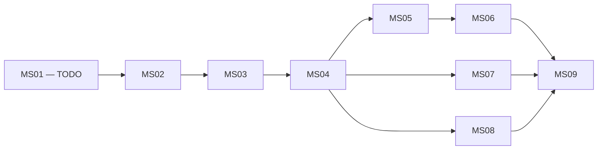

# ROADMAP — Triển khai ứng dụng đặt sân cầu lông

- **Phiên bản:** 1.0
- **Ngày cập nhật:** 02/11/2026
- **Trạng thái tài liệu:** Roadmap đã được người dùng phê duyệt và yêu cầu lưu.
- **Trạng thái triển khai:** Chưa bắt đầu; MS01 và toàn bộ milestone/task là TODO.
- **Nguồn:** [PRD.md](PRD.md), [TECH_STACK.md](TECH_STACK.md), [ARCHITECTURE.md](ARCHITECTURE.md), [DATABASE.md](DATABASE.md), [API_SPEC.md](API_SPEC.md).
- **Phạm vi:** 15 Must Have M01–M15, 14 bảng và 48 endpoint; không tự bổ sung hoặc cắt nghiệp vụ.

Việc lưu roadmap không khởi tạo source ứng dụng, cài package, tạo database hoặc chạy migration. Các file được liệt kê là file dự kiến cho những task triển khai sau này.

## 1. Mục tiêu, nguồn lực và tiến độ

### 1.1. Nguồn lực đã xác nhận

- Nhóm từ ba người trực tiếp viết code.
- Tổng thời gian cả nhóm dưới 15 giờ/tuần.
- Giữ đầy đủ MVP; chấp nhận lịch linh hoạt.
- Tuần thứ 8 là mốc đánh giá tiến độ, chưa cam kết hoàn thành toàn bộ.
- Demo ưu tiên local, giữ kiến trúc modular monolith và bộ công nghệ đã chốt.

### 1.2. Ước lượng sơ bộ

Giờ công dưới đây là tổng thời gian cộng dồn của cả nhóm dành cho lập trình, kiểm thử và tích hợp; không phải thời gian chạy công cụ hoặc số tuần lịch. Cập nhật ước lượng sau MS01/MS02 theo tốc độ thực tế.

| Milestone | Kết quả chính | Task | Giờ công dự kiến | Trạng thái |
|---|---|---:|---:|---|
| MS01 | Môi trường và nền dự án chạy được | 8 | 14–22 | TODO |
| MS02 | Schema, mapping và dữ liệu kiểm thử | 7 | 22–34 | TODO |
| MS03 | Đăng ký, đăng nhập và phiên | 11 | 30–44 | TODO |
| MS04 | Cơ sở/sân và danh mục công khai | 15 | 36–52 | TODO |
| MS05 | Khách xem lịch, đặt và hủy sân | 12 | 42–60 | TODO |
| MS06 | Lịch trực tiếp, vận hành và bảo trì | 13 | 32–48 | TODO |
| MS07 | Đăng ký chủ sân và Admin xét duyệt | 13 | 36–52 | TODO |
| MS08 | Upload, hiển thị và bảo vệ ảnh | 6 | 18–28 | TODO |
| MS09 | Nghiệm thu, APK và bộ demo | 7 | 24–36 | TODO |
| **Tổng** | **Đầy đủ MVP** | **92** | **254–376** | |
| **Có dự phòng 25%** | Học công nghệ, sửa lỗi, phối hợp | | **318–470** | |

Với mốc tham chiếu 15 giờ/tuần, tổng tương đương khoảng 22–32 tuần. Vì thời gian thực tế thấp hơn, lịch có thể dài hơn. Không chuyển ước lượng này thành cam kết khi chưa có số liệu thực tế.

### 1.3. Thứ tự frontend và backend

1. Dựng frontend và backend song song.
2. Database và hợp đồng API làm nền.
3. Backend hoàn thành từng nhóm API nhỏ; frontend tích hợp ngay nhóm đó.
4. Frontend có thể dựng component với fixture đúng DTO trong khi chờ API.
5. Chỉ DONE khi chức năng đã chạy với backend thật và qua kiểm tra liên quan.

Không đợi viết hết backend mới bắt đầu frontend. Cũng không dùng dữ liệu mock để coi tính năng đã hoàn thành tích hợp.

## 2. Phụ thuộc giữa milestone

| Milestone | Milestone cần hoàn thành trước |
|---|---|
| MS01 | Không có |
| MS02 | MS01 |
| MS03 | MS02 |
| MS04 | MS03 |
| MS05 | MS04 |
| MS06 | MS05 |
| MS07 | MS04 |
| MS08 | MS04 |
| MS09 | MS06, MS07, MS08 |

Sau MS04 ưu tiên MS05 → MS06; MS07/MS08 có thể song song khi đủ người và thời gian. Song song không làm tăng tổng giờ của nhóm. Chuẩn bị UI/fixture có thể bắt đầu sớm theo hợp đồng, nhưng task chưa DONE trước khi đáp ứng phụ thuộc và tích hợp.

## 3. Quy ước task, file và Definition of Done

### 3.1. Vai trò chủ trì đề xuất

- **A — Backend:** Spring Boot, nghiệp vụ, security.
- **B — Mobile:** React Native, UI, navigation, tích hợp.
- **C — Database/Integration:** migration, fixture, integration test; hỗ trợ UI Admin khi phù hợp.
- Mỗi task có một người chủ trì và người khác review. A/B/C là vai trò, chưa gán tên thành viên.

### 3.2. Cách đọc bảng

- Tất cả task bắt đầu ở TODO.
- Task kế thừa phụ thuộc milestone ở mục 2.
- Cột phụ thuộc thêm liệt kê task cụ thể; dấu — nghĩa là không có phụ thuộc bổ sung.
- Một dải như T01.05–T01.07 bao gồm T01.05, T01.06, T01.07.
- Dễ: cấu hình/xử lý đơn giản. TB: có tích hợp hoặc nhiều trường hợp dữ liệu. Khó: transaction, concurrency, security hoặc retry.
- File trong bảng là file chính cần tạo/cập nhật. DTO đặt trong module tương ứng theo API_SPEC; test đặt theo feature/module.

### 3.3. Ký hiệu đường dẫn

| Ký hiệu | Đường dẫn gốc |
|---|---|
| B/ | backend/src/main/java/com/example/badminton/ |
| R/ | backend/src/main/resources/ |
| BT/ | backend/src/test/ |
| F/ | mobile/src/ |
| I/ | infra/ |

Các tên file không có prefix backend đầy đủ trong một dòng cùng module được hiểu là thuộc module đang nêu. Tên test, controller/service/DTO thể hiện trách nhiệm; không yêu cầu thêm interface hoặc abstraction không cần thiết.

### 3.4. Definition of Done chung

Task chỉ DONE khi:

- Đạt tiêu chí riêng trong bảng.
- Build/typecheck liên quan chạy được.
- Có kết quả kiểm thử phù hợp.
- Không làm hỏng các kiểm tra đang có.
- Được review và tích hợp vào nhánh dùng chung.
- Nếu cần thay hợp đồng, thay đổi đã được thống nhất trước khi sửa tài liệu.

Không dùng endpoint tạm, tắt security hoặc mock dữ liệu để coi chức năng đã hoàn thành. Kiểm thử đi cùng từng task; milestone nghiệm thu cuối không thay thế kiểm thử thường xuyên.

## 4. Milestone và task chi tiết

### MS01 — Nền dự án và môi trường — TODO

**Phụ thuộc:** Không có.

**Mục tiêu:** Các máy phát triển dựng được dự án, backend kết nối PostgreSQL, mobile chạy Emulator và build được APK khung.

| ID | Trạng thái | Task/chủ trì | Phụ thuộc thêm | File chính dự kiến | Tiêu chí hoàn thành và kiểm thử | Khó |
|---|---|---|---|---|---|---|
| T01.01 | TODO | C: Kiểm tra toolchain, chọn và ghi bộ phiên bản tương thích | — | docs/SETUP.md, docs/TECH_STACK.md, README.md, .gitignore | Ghi phiên bản, nơi chạy Windows/WSL, lệnh kiểm tra; không chứa secret | TB |
| T01.02 | TODO | A: Khởi tạo Spring Boot và Maven Wrapper | T01.01 | backend/pom.xml, backend/mvnw*, B/BadmintonApplication.java | Build bằng wrapper trên máy nhóm | Dễ |
| T01.03 | TODO | C: PostgreSQL local/test và cấu hình backend | T01.01, T01.02 | I/compose.yml, cấu hình mẫu môi trường, R/application*.yml | DB local/test riêng; backend kết nối; restart không mất volume | TB |
| T01.04 | TODO | B: Khởi tạo Expo + TypeScript | T01.01 | mobile/package.json, lockfile, app.config.ts, F/app/_layout.tsx | Mở trên Emulator, typecheck thành công | Dễ |
| T01.05 | TODO | A: Nền lỗi, phân trang, thời gian và Swagger | T01.02, T01.03 | B/common/, B/config/ClockConfig.java, OpenApiConfig.java | Unit test lỗi/page; Swagger mở; Clock thay thế được trong test | TB |
| T01.06 | TODO | B: Nền UI, HTTP client và providers | T01.04 | F/providers/, F/lib/http.ts, queryClient.ts, F/config/env.ts, F/theme/ | Paper/Query chạy; phân biệt lỗi mạng/API; có UI tải/rỗng/lỗi | TB |
| T01.07 | TODO | C: Thiết lập test harness | T01.03, T01.05, T01.06 | BT/ cấu hình test, mobile/jest.config.*, test setup | Backend test dùng PostgreSQL riêng; component test mobile chạy được | TB |
| T01.08 | TODO | C: Smoke test và APK khung trên máy thứ hai | T01.05–T01.07 | docs/SETUP.md, cấu hình build Android | Mobile kiểm tra kết nối Swagger trong dev; APK khung mở khi Metro tắt | TB |

**Cổng hoàn thành:** Có thể dựng lại môi trường theo hướng dẫn. Không thêm API nghiệp vụ chỉ để kiểm tra kết nối.

### MS02 — Database, mapping và fixture — TODO

**Phụ thuộc:** MS01.

**Mục tiêu:** Schema 14 bảng đúng thiết kế, ORM validate thành công và có dữ liệu kiểm thử cho tính năng sau.

| ID | Trạng thái | Task/chủ trì | Phụ thuộc thêm | File chính dự kiến | Tiêu chí hoàn thành và kiểm thử | Khó |
|---|---|---|---|---|---|---|
| T02.01 | TODO | C: Identity schema và mapping | — | R/db/migration/V001__identity_schema.sql, B/identity/entity/ | Bốn bảng identity đúng khóa; test email, role ghép, hash, hạn phiên | TB |
| T02.02 | TODO | C: Hồ sơ và lịch sử xét duyệt | T02.01 | V002__owner_application_schema.sql, B/ownerapplication/entity/ | Hai bảng đúng FK/UNIQUE; JSONB đọc/ghi; lý do từ chối hợp lệ | TB |
| T02.03 | TODO | C: Media, cơ sở và sân | T02.02 | V003__venue_media_schema.sql, entity của media/ và venue/ | Ba bảng đúng FK; tên sân trùng giữa hai cơ sở được phép, cùng cơ sở bị chặn | TB |
| T02.04 | TODO | A/C: Đơn và chi tiết khung | T02.03 | V004__booking_schema.sql, B/booking/entity/Booking*.java | Hai bảng đúng CHECK, tiền generated; ORM không ghi cột generated | TB |
| T02.05 | TODO | A/C: Bảo trì và occupancy | T02.04 | V005__maintenance_occupancy_schema.sql, entity/key tương ứng | Ba bảng đúng khóa ghép; sai nguồn/sân/ngày/khung bị từ chối | Khó |
| T02.06 | TODO | C: Indexes và kiểm thử schema | T02.05 | V006__query_indexes.sql, BT/.../SchemaIntegrityIT.java | Đủ 14 bảng; FK/UNIQUE/CHECK được kiểm tra âm-dương; không index trùng không cần thiết | TB |
| T02.07 | TODO | C: Fixture và seed local có kiểm soát | T02.06 | R/db/demo/demo_seed.sql, BT/resources/fixtures/, hướng dẫn seed | Có khách/Admin/hai chủ/nhiều cơ sở; không seed prod; hồ sơ nguồn/quyền nhất quán | TB |

Tên các file V002–V006 trong bảng cùng nằm dưới R/db/migration/. Demo seed không nằm trong chuỗi migration schema tự chạy ở mọi môi trường. Các test của từng task dùng fixture tối thiểu của chính task, không phải chờ bộ demo hoàn chỉnh.

**Cổng hoàn thành:** DB rỗng chạy hết migration, Hibernate validate thành công. Không dùng ddl-auto=update để chữa mapping.

### MS03 — Tài khoản và authentication hoàn chỉnh — TODO

**Phụ thuộc:** MS02.

**Mục tiêu:** Đăng ký, login, khôi phục phiên, refresh và logout xuyên mobile–backend.

| ID | Trạng thái | Task/chủ trì | Phụ thuộc thêm | File chính dự kiến | Tiêu chí hoàn thành và kiểm thử | Khó |
|---|---|---|---|---|---|---|
| T03.01 | TODO | A: API đăng ký | — | B/identity/controller/AuthController.java, RegistrationService.java, DTO | Email chuẩn hóa; chỉ CUSTOMER; mật khẩu và email trùng được kiểm tra | TB |
| T03.02 | TODO | A: Token và lưu phiên | — | TokenService.java, SessionService.java, repository phiên trong identity/ | JWT đúng hạn; refresh chỉ lưu hash; test Clock cố định | Khó |
| T03.03 | TODO | A: API login | T03.02 | AuthController, LoginService.java | Đúng trả token; sai email/mật khẩu cùng lỗi; không lộ xác thực | TB |
| T03.04 | TODO | A: Xác thực request và GET /me | T03.02 | B/config/SecurityConfig.java, kiểm tra phiên, MeController.java | 401/403 đúng; quyền hiện tại; phiên thu hồi bị chặn | Khó |
| T03.05 | TODO | A: API refresh | T03.03, T03.04 | RefreshService.java, AuthController | Không kéo dài 7 ngày; hết hạn/thu hồi bị từ chối | TB |
| T03.06 | TODO | A: API logout | T03.04 | LogoutService.java, AuthController | Access hết hạn vẫn logout được; replay 204; access cũ không dùng tiếp | TB |
| T03.07 | TODO | B: Form đăng ký | T03.01 | F/features/auth/screens/RegisterScreen.tsx, API/form validation | Lỗi trường/email trùng; đăng ký xong không giả định đã login | TB |
| T03.08 | TODO | B: Form login và lưu token | T03.03, T03.04 | LoginScreen.tsx, F/features/auth/api/, F/providers/AuthProvider.tsx | Access ở memory, refresh ở SecureStore; lỗi không mất form | TB |
| T03.09 | TODO | B: Khôi phục phiên khi mở app | T03.05, T03.08 | AuthProvider, sessionStorage.ts | Có trạng thái chờ; lỗi mạng giữ refresh; token hết hạn kết thúc phiên | Khó |
| T03.10 | TODO | B: Refresh một tác vụ dùng chung | T03.09 | F/lib/http.ts, test interceptor | Nhiều 401 chỉ một refresh; retry tối đa một lần; không refresh vì 403 | Khó |
| T03.11 | TODO | B/C: Logout, cache và route theo quyền | T03.06, T03.10 | Layout bảo vệ, AuthProvider, test phiên | Đổi tài khoản không lộ cache; offline logout diễn đạt đúng; ba vai trò vào đúng khu vực | TB |

**Cổng hoàn thành:** Đủ 5 endpoint tài khoản; mở lại app khôi phục được phiên. Chưa cần các tính năng khác để kiểm chứng.

### MS04 — Cơ sở, sân và danh mục công khai — TODO

**Phụ thuộc:** MS03.

**Mục tiêu:** Chủ quản lý nhiều cơ sở/sân, khách xem danh mục thật. Dùng placeholder khi photo = null trong giai đoạn này.

| ID | Trạng thái | Task/chủ trì | Phụ thuộc thêm | File chính dự kiến | Tiêu chí hoàn thành và kiểm thử | Khó |
|---|---|---|---|---|---|---|
| T04.01 | TODO | A: Quyền sở hữu và khóa cơ sở | — | B/venue/service/VenueAccessService.java, VenueRepository | Chủ A không truy cập chủ B; sai cha–con 404; lấy khóa trong transaction | TB |
| T04.02 | TODO | A: Danh sách/chi tiết cơ sở của chủ | T04.01 | OwnerVenueController.java, query service/DTO | Phân trang ổn định, gồm cả cơ sở chưa công khai | TB |
| T04.03 | TODO | A: API thêm cơ sở | T04.01 | VenueService.java, OwnerVenueController | Owner từ phiên; nguồn hồ sơ null; thêm được cơ sở thứ hai | TB |
| T04.04 | TODO | A: Cập nhật cơ sở, bảo vệ lịch khi đổi giờ | T04.01 | VenueScheduleGuard.java, B/booking/service/BookedScheduleGuard.java, VenueService | PATCH thiếu/null đúng; không vô hiệu hóa đơn; test lịch đã có | Khó |
| T04.05 | TODO | A: Danh sách/chi tiết sân của chủ | T04.01 | OwnerCourtController.java, query/DTO | Đúng cơ sở, active filter và phân trang | TB |
| T04.06 | TODO | A: API tạo sân | T04.01 | CourtService.java, OwnerCourtController | Giá dương; tên chuẩn hóa duy nhất trong cơ sở | TB |
| T04.07 | TODO | A: Sửa sân, giá và active | T04.06 | CourtService, PATCH DTO | Không chuyển cơ sở; inactive không hủy đơn; giá mới không đổi snapshot | TB |
| T04.08 | TODO | A: Danh sách/chi tiết cơ sở công khai | T04.02 | PublicVenueController.java, query điều kiện công khai | Thiếu giờ/sân active không hiển thị; DTO không lộ tài khoản chủ | TB |
| T04.09 | TODO | A: Danh sách/chi tiết sân công khai | T04.05, T04.08 | PublicCourtController.java, public DTO | Chỉ active, đúng cha–con, phân trang đúng | TB |
| T04.10 | TODO | B: Danh sách cơ sở cho khách | T04.08 | F/features/venues/screens/VenueListScreen.tsx, query hook | API thật; tải/rỗng/lỗi/thử lại và tải trang tiếp | TB |
| T04.11 | TODO | B: Chi tiết cơ sở và sân | T04.09, T04.10 | VenueDetailScreen.tsx, CourtDetailScreen.tsx | Địa chỉ/tiện ích/giá đúng; điều hướng đúng ID | TB |
| T04.12 | TODO | B: Danh sách/chuyển cơ sở của chủ | T04.02 | OwnerVenueListScreen.tsx, hook chọn cơ sở | Chủ có hai cơ sở; chuyển không lẫn cache | TB |
| T04.13 | TODO | B: Form thêm/sửa cơ sở | T04.03, T04.04, T04.12 | VenueFormScreen.tsx, form/API | Tạo/sửa qua API; lỗi giờ/xung đột rõ ràng | TB |
| T04.14 | TODO | B: Danh sách/chi tiết sân quản lý | T04.05, T04.12 | OwnerCourtListScreen.tsx, OwnerCourtDetailScreen.tsx | Hiện cả inactive; filter đúng cơ sở | TB |
| T04.15 | TODO | B: Form sân, giá và trạng thái | T04.06, T04.07, T04.14 | CourtFormScreen.tsx, form/API | Tên trùng/giá sai có lỗi; tiền gửi string; không mất form | TB |

VenueScheduleGuard là contract hẹp kiểm tra ảnh hưởng lịch, tránh vòng phụ thuộc trực tiếp giữa VenueService và BookingService. Guard được kiểm tra bằng dữ liệu booking fixture từ schema đã có, không cần chờ API đặt sân.

**Cổng hoàn thành:** Đủ 12 endpoint tương ứng. Chủ thêm cơ sở → tạo sân → khách nhìn thấy chạy được với API/DB thật.

### MS05 — Khách xem lịch, đặt và hủy sân — TODO

**Phụ thuộc:** MS04.

**Mục tiêu:** Luồng đặt sân hoàn chỉnh; kiểm tra chống trùng và gửi lặp từ sớm.

| ID | Trạng thái | Task/chủ trì | Phụ thuộc thêm | File chính dự kiến | Tiêu chí hoàn thành và kiểm thử | Khó |
|---|---|---|---|---|---|---|
| T05.01 | TODO | A: Quy tắc ngày/giờ/giá và hạn hủy | — | B/booking/service/BookingPolicy.java, tiện ích giờ/tiền | Test 23–24, bảy ngày, tràn tiền, mốc 24 giờ bằng Clock | TB |
| T05.02 | TODO | A: Hai API availability public/owner | T05.01 | AvailabilityService.java, controllers/DTO | Thứ tự trạng thái đúng; không lộ khách; hai phạm vi đúng quyền | TB |
| T05.03 | TODO | B: Lịch ngày và chọn khung liên tiếp | T05.02 | F/features/bookings/components/SlotPicker.tsx, AvailabilityScreen.tsx | Chỉ chọn khung hợp lệ/liên tiếp; refresh bỏ lựa chọn đã mất | TB |
| T05.04 | TODO | A: Transaction tạo đơn và occupancy | T05.01 | BookingCommandService.java, booking/occupancy repositories | Integration test: đủ mọi khung hoặc rollback; giá/khách là snapshot | Khó |
| T05.05 | TODO | A: Nhận diện ý định đặt và replay | T05.04 | BookingRequestFingerprint.java, xử lý idempotency | Cùng key cùng đơn; khác nội dung bị chặn; replay không so giá mới | Khó |
| T05.06 | TODO | A: POST /bookings | T05.05 | CustomerBookingController.java, create DTO/mapper | Đúng 201/200, Location, 409/422; không nhận owner/total/status tùy ý | TB |
| T05.07 | TODO | A: Danh sách/chi tiết đơn cá nhân | T05.04 | BookingQueryService.java, customer controller | View/status/page đúng; không đọc đơn khác; DIRECT không tự liên kết | TB |
| T05.08 | TODO | A: API khách hủy | T05.01, T05.07 | BookingCancellationService.java, cancel DTO | Mốc 24 giờ đúng; giữ lịch sử, giải phóng khung; replay giữ metadata | Khó |
| T05.09 | TODO | B: Xác nhận đặt, giá đổi và retry | T05.03, T05.06 | BookingConfirmScreen.tsx, mutation hook | Giữ key qua retry/refresh; giá mới cần xác nhận và key mới | Khó |
| T05.10 | TODO | B: Lịch cá nhân và chi tiết | T05.07 | MyBookingsScreen.tsx, BookingDetailScreen.tsx | Tabs/lọc/page đúng; không tự đánh dấu hoàn thành | TB |
| T05.11 | TODO | B: Hủy trên mobile và cập nhật cache | T05.08, T05.10 | CancelBookingDialog.tsx, cancel hook | Xác nhận hủy; đơn/lịch trống cập nhật; lỗi quá hạn rõ ràng | TB |
| T05.12 | TODO | C: Race và mất response | T05.06, T05.08, T05.09 | BT/.../BookingConcurrencyIT.java, IdempotencyIT.java, component tests | Hai yêu cầu trùng một thành công; retry không tạo thêm; nhiều khung rollback sạch | Khó |

**Cổng hoàn thành:** Khách login → chọn sân → đặt → xem đơn → hủy → thấy khung trống trở lại. Có bằng chứng concurrency trên PostgreSQL.

### MS06 — Vận hành chủ sân, lịch trực tiếp và bảo trì — TODO

**Phụ thuộc:** MS05.

| ID | Trạng thái | Task/chủ trì | Phụ thuộc thêm | File chính dự kiến | Tiêu chí hoàn thành và kiểm thử | Khó |
|---|---|---|---|---|---|---|
| T06.01 | TODO | A: Lịch/chi tiết đơn cơ sở | — | OwnerBookingController.java, owner query/DTO | Filter ngày/sân/status; xem lịch sử; không đọc cơ sở khác | TB |
| T06.02 | TODO | A: API đặt trực tiếp | — | DirectBookingService.java, DirectBookingRequest | Chung cơ chế tạo/khóa/key; DIRECT không có tài khoản khách | Khó |
| T06.03 | TODO | A: API chủ hủy | — | OwnerBookingController, cancellation policy | Trước bắt đầu, lý do bắt buộc; không áp hạn 24 giờ của khách | TB |
| T06.04 | TODO | A: API hoàn thành | — | BookingCompletionService.java | Chưa hết giờ bị chặn; replay không đổi timestamp | TB |
| T06.05 | TODO | A: API tạo bảo trì | — | MaintenanceService.java, create controller/DTO | Chung occupancy; tương lai/trong giờ; xung đột đúng quyền | Khó |
| T06.06 | TODO | A: Danh sách/chi tiết bảo trì | T06.05 | Maintenance query service/controller | Date/court/isReleased và phân trang đúng | TB |
| T06.07 | TODO | A: API gỡ bảo trì | T06.05 | Maintenance release service/controller | Ghi metadata, giữ chi tiết, xóa occupancy; gọi lặp an toàn | TB |
| T06.08 | TODO | B: Lịch quản lý cơ sở/ngày | T06.01 | OwnerBookingsScreen.tsx, filter/query hooks | Đổi cơ sở/ngày/sân không lẫn dữ liệu; page đúng | TB |
| T06.09 | TODO | B: Chi tiết và hành động chủ | T06.03, T06.04, T06.08 | OwnerBookingDetailScreen.tsx, action dialogs | Hủy có lý do; hoàn thành đúng lúc; lỗi theo server | TB |
| T06.10 | TODO | B: Form đặt trực tiếp | T06.02 | DirectBookingFormScreen.tsx | Đúng sân/liên hệ; giá đổi/retry dùng quy tắc chung | TB |
| T06.11 | TODO | B: Danh sách/chi tiết bảo trì | T06.06 | MaintenanceListScreen.tsx, MaintenanceDetailScreen.tsx | Xem đã gỡ/còn hiệu lực đúng cơ sở | TB |
| T06.12 | TODO | B: Tạo/gỡ bảo trì trên mobile | T06.05, T06.07, T06.11 | MaintenanceFormScreen.tsx, release hook | Hiện xung đột; không tự hủy đơn; invalidate lịch | TB |
| T06.13 | TODO | C: Kiểm thử lịch dùng chung | T06.02–T06.07 | BookingMaintenanceConcurrencyIT.java, lifecycle tests | APP–DIRECT–bảo trì không chồng; hủy/gỡ không mất lịch sử hoặc khôi phục đơn | Khó |

**Cổng hoàn thành:** Đủ 9 endpoint vận hành/bảo trì; chủ quản lý được lịch trực tuyến lẫn trực tiếp.

### MS07 — Chủ sân đăng ký và Admin xét duyệt — TODO

**Phụ thuộc:** MS04; có thể song song MS05/MS06.

| ID | Trạng thái | Task/chủ trì | Phụ thuộc thêm | File chính dự kiến | Tiêu chí hoàn thành và kiểm thử | Khó |
|---|---|---|---|---|---|---|
| T07.01 | TODO | A: Gửi hồ sơ lần đầu | — | OwnerApplicationService.java, customer controller/DTO | Một hồ sơ; chưa cấp OWNER; email từ tài khoản | TB |
| T07.02 | TODO | A: Hồ sơ/lịch sử cá nhân | T07.01 | Application query service/DTO | Chỉ hồ sơ mình; page review; snapshot đúng lần | TB |
| T07.03 | TODO | A: Sửa hồ sơ bị từ chối | T07.01 | Update service/DTO | PUT đủ; chỉ REJECTED; không tự đổi lần gửi/quyền | TB |
| T07.04 | TODO | A: API gửi lại | T07.03 | Resubmit service/DTO | submissionNo khớp, tăng đúng một lần, giữ review | TB |
| T07.05 | TODO | A: Admin danh sách/chi tiết/lịch sử hồ sơ | T07.02 | AdminApplicationController.java, admin query | Chỉ ADMIN; filter/page/order đúng; không lộ hash/token | TB |
| T07.06 | TODO | A: Chấp thuận và transaction | T07.01, T07.05 | ApplicationApprovalService.java, identity cấp quyền, venue tạo từ hồ sơ | OWNER/cơ sở/review cùng commit; stale/replay đúng | Khó |
| T07.07 | TODO | A: API từ chối | T07.05 | Rejection service/DTO | Lý do bắt buộc; snapshot bất biến; quyết định khác/replay đúng | TB |
| T07.08 | TODO | A/C: Ba API tra cứu chủ | T07.06 | AdminOwnerController.java, owner projection/query | venueCount/approvedAt đúng; gồm cơ sở thêm; tránh query lặp thừa | TB |
| T07.09 | TODO | B: Form đăng ký/sửa hồ sơ | T07.01, T07.03 | OwnerApplicationFormScreen.tsx | Dùng chung form; pending/approved không sửa được | TB |
| T07.10 | TODO | B: Trạng thái/lịch sử/gửi lại | T07.02, T07.04 | OwnerApplicationStatusScreen.tsx, review component | Thấy lý do/snapshot cũ; resubmit cập nhật trạng thái/lần gửi | TB |
| T07.11 | TODO | B/C: UI Admin xét duyệt | T07.05–T07.07 | AdminApplicationsScreen.tsx, detail/action screens | Gửi số lần đang xem; stale yêu cầu tải lại; từ chối có lý do | TB |
| T07.12 | TODO | B/C: UI tra cứu chủ/cơ sở | T07.08 | AdminOwnersScreen.tsx, owner detail/venues screens | Chỉ đọc; không có thao tác lịch/giá thay chủ | TB |
| T07.13 | TODO | C: Toàn luồng và rollback | T07.06–T07.12 | ApplicationApprovalIT.java, role-refresh/component tests | Duyệt đồng thời một kết quả; không cấp quyền một phần; /me nhận OWNER không cần tài khoản mới | Khó |

**Cổng hoàn thành:** Đủ 13 endpoint hồ sơ/Admin. Bị từ chối → sửa → gửi lại → duyệt → thêm cơ sở thứ hai chạy trên mobile.

### MS08 — Ảnh cơ sở và sân — TODO

**Phụ thuộc:** MS04; có thể song song MS05–MS07.

| ID | Trạng thái | Task/chủ trì | Phụ thuộc thêm | File chính dự kiến | Tiêu chí hoàn thành và kiểm thử | Khó |
|---|---|---|---|---|---|---|
| T08.01 | TODO | A: Storage và validation file | — | B/media/service/LocalMediaStorage.java, image validator | JPEG/PNG/WebP thật; tối đa 5.242.880 byte; tên server sinh; không nhận đường dẫn tùy ý | TB |
| T08.02 | TODO | A: Hai API upload/thay ảnh | T08.01 | Owner photo controllers, media metadata service | Đúng sở hữu; gắn ảnh sau lưu; DB lỗi xử lý file mới, không xóa ảnh cũ trước commit | TB |
| T08.03 | TODO | A: API tải ảnh theo quyền | T08.02 | MediaController.java, media visibility service | Public đúng tài nguyên công khai; ảnh riêng đúng quyền; không lộ storage key | Khó |
| T08.04 | TODO | B: Chọn ảnh và upload | T08.02 | F/components/PhotoPicker.tsx, usePhotoUpload.ts | Hủy chọn không lỗi; multipart đúng; lỗi dung lượng/định dạng rõ | TB |
| T08.05 | TODO | B: Hiển thị ảnh public/private | T08.03, T08.04 | Component ảnh chung, màn hình cơ sở/sân | Tải từ Emulator/điện thoại; ảnh riêng dùng phiên đúng; lỗi có placeholder | TB |
| T08.06 | TODO | C: Test ảnh và lỗi lưu trữ | T08.01–T08.05 | MediaAccessIT.java, fixture ảnh, component tests | File giả MIME/quá dung lượng, ảnh không tham chiếu, lỗi filesystem/DB được kiểm tra | TB |

**Cổng hoàn thành:** Đủ 3 endpoint ảnh; upload, thay và quyền đọc được kiểm chứng.

### MS09 — Nghiệm thu và bàn giao — TODO

**Phụ thuộc:** MS06, MS07, MS08.

Đây là kiểm tra toàn hệ thống, không thay kiểm thử đã làm trong từng task. Kiểm tra lại để nghiệm thu tích hợp; không viết lại các test đã đủ chỉ để tăng số lượng.

| ID | Trạng thái | Task/chủ trì | Phụ thuộc thêm | File chính dự kiến | Tiêu chí hoàn thành và kiểm thử | Khó |
|---|---|---|---|---|---|---|
| T09.01 | TODO | C: Ma trận bao phủ PRD/API | — | docs/ACCEPTANCE.md, contract tests còn thiếu | M01–M15 và 48 endpoint đều có nơi triển khai, test, kết quả | TB |
| T09.02 | TODO | A/C: Regression backend/database | T09.01 | Integration/security tests liên quan | Quyền/transaction/key/thời gian đủ; sửa lỗi phát hiện trước nghiệm thu | Khó |
| T09.03 | TODO | B/C: Regression mobile | T09.01 | Component/integration tests liên quan | Không lẫn cache, không thành công giả; quyền mới/mất mạng/lỗi API đúng | TB |
| T09.04 | TODO | B: Build APK nghiệm thu | T09.02, T09.03 | Cấu hình build, thông tin phiên bản artifact | Cài sạch, Metro tắt, backend URL đúng môi trường | TB |
| T09.05 | TODO | C: Dữ liệu và kịch bản demo tái tạo | — | Seed local, docs/DEMO.md, ảnh mẫu | Hai chủ/nhiều cơ sở, trạng thái hồ sơ/lịch/bảo trì; ngày demo không hết hạn | TB |
| T09.06 | TODO | C: Dựng máy khác từ hướng dẫn | T09.04, T09.05 | README.md, docs/SETUP.md, phiên bản trong TECH_STACK | Lockfile/wrapper, migration thành công; không cần bí mật ngoài hướng dẫn mẫu | TB |
| T09.07 | TODO | Cả nhóm: Diễn tập/chốt bàn giao | T09.06 | docs/ACCEPTANCE.md, docs/DEMO.md, ghi nhận artifact | Chạy đầy đủ kịch bản; lưu kết quả, lỗi còn lại, APK nộp | Dễ |

**Cổng hoàn thành:** APK, backend/database local dựng lại được, bộ demo và bằng chứng nghiệm thu. Không còn lỗi gây đặt trùng, vượt quyền hoặc mất dữ liệu trong luồng bắt buộc.

## 5. Bao phủ phạm vi và cách kiểm thử

### 5.1. Ma trận chức năng/API

| Phần | Milestone chính | Endpoint |
|---|---|---:|
| M01 — Tài khoản/phiên | MS03 | 5 |
| M02, M07, M15 — Danh mục và quản lý cơ sở/sân | MS04 | 12 |
| M03–M06 — Availability và đơn cá nhân | MS05 | 6 |
| M08–M10 — Vận hành, trực tiếp, bảo trì | MS06 | 9 |
| M11–M14 — Hồ sơ và Admin | MS07 | 13 |
| Ảnh hỗ trợ cơ sở/sân | MS08 | 3 |
| **Tổng** | | **48** |

Các số endpoint là phân bổ của API_SPEC, không bổ sung API mới. Hai endpoint availability nằm MS05; API danh mục công khai còn lại nằm MS04.

### 5.2. Chiến lược kiểm thử

- **Schema:** migration trên PostgreSQL test; dữ liệu hợp lệ và dữ liệu vi phạm constraint.
- **Service:** JUnit/Mockito, Clock điều khiển được cho mốc thời gian.
- **Transaction/concurrency:** PostgreSQL thật, kết nối/transaction độc lập; không kết luận chống trùng chỉ bằng mock.
- **API:** status, DTO, error, phân trang, cha–con và ownership.
- **Mobile:** Jest, jest-expo, React Native Testing Library; hành vi, form và trạng thái lỗi.
- **Tích hợp:** Emulator sau mỗi milestone có UI, API/backend thật.
- **Release:** APK độc lập, cài sạch, Metro tắt.

Backend test không dùng database local của thành viên để reset dữ liệu. Fixture của từng task độc lập với demo seed. Snapshot ảnh/file cho test đặt trong môi trường test, không đè upload local.

## 6. Nhịp làm việc và cập nhật tiến độ

- Mỗi người chỉ giữ một task đang làm.
- Tích hợp sớm bằng thay đổi nhỏ; không giữ riêng module nhiều tuần.
- Khi nhận task, đọc đúng phần liên quan trong tài liệu đã duyệt.
- Người làm migration phối hợp số version để tránh xung đột.
- Không sửa migration đã được nhóm áp dụng; thêm migration mới.
- Sau milestone: demo đầu ra, ghi giờ thực tế, cập nhật ước lượng còn lại.
- Nếu cần đổi API/schema/nghiệp vụ, ghi vấn đề và thống nhất trước khi triển khai lệch tài liệu.
- Trạng thái theo dõi có thể dùng TODO → IN_PROGRESS → REVIEW → DONE; BLOCKED ghi rõ phụ thuộc/lý do. Không đổi DONE chỉ vì đã viết file mà chưa qua tiêu chí.

**Mốc tuần thứ 8:** Đánh giá môi trường, database, authentication và phần danh mục đạt được. Không báo hoàn thành MVP chỉ vì hết tám tuần hoặc đã có UI demo. Quỹ dưới 15 giờ/tuần không được hiểu thành 15 giờ cho mỗi người.

## 7. Rủi ro và biện pháp

| Rủi ro | Hướng xử lý trong roadmap |
|---|---|
| Quỹ thời gian thấp | Lịch linh hoạt; đo tốc độ MS01/MS02; không tự cắt Must Have |
| Mới với Spring/React Native | Task nhỏ, review chéo; môi trường/auth lên đầu |
| Bộ version không tương thích | T01.01 và APK khung trước khi làm nhiều màn hình |
| Windows–WSL/OneDrive | Chốt nơi chạy toolchain, kiểm tra máy khác; không tự di chuyển source |
| Frontend/backend lệch hợp đồng | API_SPEC, DTO/contract test; tích hợp từng nhóm nhỏ |
| Vòng phụ thuộc service | Tách quyền/khóa và contract kiểm tra lịch, tránh hai service lớn gọi vòng |
| Đặt trùng/retry tạo thêm | Constraint MS02, transaction/key MS05, race liên nghiệp vụ MS06 |
| Quyền chủ mới chưa cập nhật | Backend kiểm tra quyền hiện tại và /me; test MS07 |
| Demo làm sai kiểm thử | Tách fixture test, seed local và vận hành |
| Ảnh/JWT lộ qua log/response | Kiểm tra DTO, log và quyền đọc ở task tương ứng |
| Cuối kỳ mới phát hiện lỗi build | APK khung MS01; APK độc lập MS09 |
| Demo hết hạn ngày đặt | Seed theo ngày demo; test nghiệp vụ dùng Clock cố định |

## 8. Điều kiện bàn giao và giới hạn

- Bàn giao đầy đủ MVP M01–M15 theo tiêu chí PRD và hợp đồng API_SPEC.
- Có APK cài được, backend/database local dựng lại được, bộ demo và kết quả kiểm thử.
- Không còn lỗi đặt trùng, vượt quyền, tạo đơn lặp hoặc mất lịch sử ở các kịch bản bắt buộc.
- Should Have/Could Have chưa nằm trong kế hoạch triển khai.
- Không thêm thanh toán, thông báo, QR, bản đồ, chat, đánh giá, microservices hoặc hạ tầng phân tán.
- Chưa tạo source, cài dependency, tạo database hay chạy migration chỉ bằng việc lưu tài liệu này.
- Bước thực thi đầu tiên là **MS01 — TODO**, bắt đầu từ **T01.01 — TODO** khi được yêu cầu triển khai ứng dụng.
