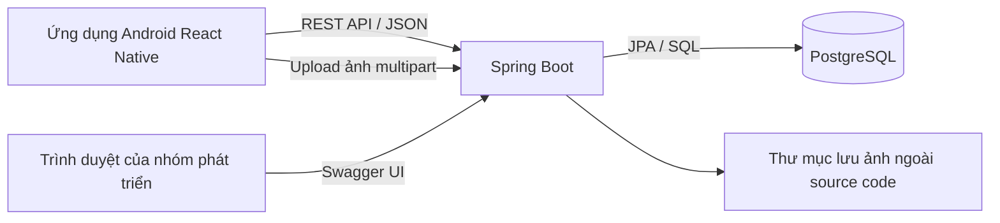

# TECH STACK — Ứng dụng Android đặt sân cầu lông

- **Phiên bản tài liệu:** 1.0
- **Ngày cập nhật:** 02/11/2026
- **Trạng thái:** Bộ công nghệ đã được người dùng thống nhất và yêu cầu lưu tài liệu.
- **Tài liệu nghiệp vụ:** [PRD.md](PRD.md).
- **Phạm vi:** Công nghệ cho MVP M01–M15; ba vai trò Khách hàng, Chủ sân, Admin; một chủ quản lý nhiều cơ sở.

Tài liệu này chốt các lựa chọn công nghệ và nguyên tắc sử dụng. Các phiên bản dependency cụ thể sẽ được kiểm tra tương thích khi thiết lập dự án rồi khóa lại. Chưa có môi trường cài đặt hoặc bản build được xác minh chỉ từ việc tạo tài liệu này.

## 1. Nguyên tắc lựa chọn

- Phù hợp sinh viên, dễ học, dễ debug, có tài liệu chính thức.
- Tận dụng kinh nghiệm Java của nhóm và kinh nghiệm backend/FastAPI đã có.
- Một backend monolith, một PostgreSQL; chia module theo nghiệp vụ.
- Chỉ thêm thư viện khi có nhu cầu rõ trong MVP.
- Kiểm tra quyền sở hữu và tính đúng đắn của lịch đặt ở backend/database.
- Công nghệ không làm thay đổi quy tắc hoặc bổ sung chức năng ngoài PRD.
- Ưu tiên bộ phiên bản đã thử chạy cùng nhau, không chọn mọi thành phần chỉ vì mới nhất.

## 2. Bộ công nghệ đã chọn

| Thành phần | Lựa chọn | Vai trò |
|---|---|---|
| Mobile | React Native + TypeScript | Giao diện và logic tương tác Android |
| Framework mobile | Expo | Công cụ phát triển, native modules và build |
| Navigation | Expo Router | Stack, Tabs và tổ chức màn hình theo nhóm |
| Dữ liệu server | TanStack Query | Tải, cache và cập nhật dữ liệu API |
| State giao diện | React hooks + Context | State cục bộ và phiên đăng nhập dùng chung |
| UI | React Native Paper + StyleSheet | Component chung và bố cục riêng |
| Biểu mẫu | React Hook Form | Giá trị, lỗi và trạng thái gửi form |
| HTTP client | Axios | REST API, header, timeout, xử lý lỗi dùng chung |
| Lưu xác thực | Expo SecureStore | Lưu thông tin xác thực cần lưu bền trên thiết bị |
| Chọn ảnh | Expo ImagePicker | Chọn ảnh cơ sở/sân từ thiết bị |
| Backend | Java 21 + Spring Boot | API, phân quyền và nghiệp vụ |
| Build backend | Maven Wrapper | Tải dependency, build và test |
| Persistence | Spring Data JPA / Hibernate | Repository, ORM và transaction |
| Database | PostgreSQL | Dữ liệu quan hệ và ràng buộc toàn vẹn |
| Migration | Flyway | Quản lý phiên bản cấu trúc database |
| Xác thực | Spring Security + JWT | Xác thực request và kiểm soát quyền |
| Tài liệu API | springdoc-openapi + Swagger UI | Sinh OpenAPI và thử API trên trình duyệt |
| Môi trường database | Docker Compose | Chạy PostgreSQL local nhất quán |
| Kiểm thử backend | JUnit + Mockito, kiểm thử tích hợp PostgreSQL | Nghiệp vụ, phân quyền, transaction và đồng thời |
| Xem database | DBeaver, tùy chọn | Xem bảng, dữ liệu và chạy SQL |
| Công cụ làm việc | VS Code, Android Studio Emulator, Git | Viết code, chạy Android và quản lý phiên bản |

Zustand và Redux chưa được sử dụng. pgAdmin là phương án thay DBeaver. Cài PostgreSQL trực tiếp là phương án thay Docker khi máy hạn chế tài nguyên.

## 3. Kiến trúc tổng thể

- App gọi backend; không kết nối trực tiếp database.
- Cả ba vai trò dùng cùng ứng dụng Android, hiển thị chức năng theo quyền.
- Backend tổ chức theo các nhóm tài khoản/xác thực, hồ sơ chủ sân, cơ sở/sân, đặt sân/bảo trì và ảnh.
- Trong mỗi nhóm tách trách nhiệm API, xử lý nghiệp vụ và truy cập dữ liệu.
- Quan hệ sở hữu: người dùng → các cơ sở thuộc sở hữu → sân → lịch đặt/bảo trì.
- Admin chỉ có quyền nghiệp vụ được PRD quy định; không mặc định được sửa mọi đơn đặt hoặc giá sân.

**Lý do:** Quy mô MVP phù hợp một ứng dụng backend, thuận tiện phát triển và thực hiện transaction.

**Ưu điểm:** Ít dịch vụ cần vận hành, dễ theo dõi lỗi, dễ chia việc theo module.

**Nhược điểm:** Cần giữ ranh giới module để tránh trộn nghiệp vụ hoặc tạo service quá lớn.

**Độ khó:** Trung bình. **Thay thế:** Microservices chỉ xem xét nếu có nhu cầu triển khai và mở rộng độc lập trong tương lai; không thuộc MVP.

## 4. Frontend Android

### 4.1. React Native, TypeScript và Expo

React Native dùng để xây ứng dụng Android; TypeScript là ngôn ngữ viết frontend. Expo cung cấp framework, công cụ chạy dự án, native modules và quy trình build trên nền React Native.

| Lựa chọn | Lý do và ưu điểm | Nhược điểm/lưu ý | Độ khó | Thay thế |
|---|---|---|---|---|
| React Native + TypeScript | Đúng công nghệ bắt buộc; có type checking, component dùng lại được | Cần học React, lifecycle và đặc điểm mobile; type không thay thế validation runtime | Trung bình | Android native thay đổi hướng frontend đã duyệt |
| Expo | Giảm cấu hình native; phù hợp form, ảnh, lịch và API trong PRD | Phải tuân bộ phiên bản SDK; thay đổi native dependency có thể cần build lại | Thấp–trung bình | React Native Community CLI, nhiều cấu hình hơn |

Quy trình sử dụng Expo:

1. Có thể dùng Expo Go để thử nhanh nếu SDK và các thư viện cần dùng được hỗ trợ.
2. Chuyển sớm sang development build để kiểm tra ứng dụng với đúng native dependency.
3. Bản nghiệm thu là APK chạy độc lập, kiểm tra khi Metro đã tắt.

Expo Go là ứng dụng chạy thử. Development build là bản phát triển riêng của dự án. APK nghiệm thu được đóng gói để người dùng cài và chạy, vẫn cần Internet tới backend theo PRD.

Người dùng cuối không cài Node.js, Java backend, Maven hoặc từng npm package. Những công cụ đó phục vụ máy phát triển và máy chạy backend.

### 4.2. Điều hướng: Expo Router

Tổ chức các nhóm màn hình công khai, đăng nhập/đăng ký, khách hàng, chủ sân và Admin. Dùng Stack/Tabs theo trải nghiệm đã thiết kế; chuyển nhóm màn hình theo phiên và quyền hiện tại.

- **Lý do/ưu điểm:** Phù hợp Expo; route theo cấu trúc file, dễ tìm và tổ chức màn hình.
- **Nhược điểm:** Cần hiểu layout, route group, tham số và trạng thái khôi phục phiên.
- **Độ khó:** Trung bình.
- **Thay thế:** React Navigation trực tiếp nếu thay đổi lựa chọn navigation sau này; không dựng song song hai kiến trúc navigation độc lập.

Chặn route ở frontend hỗ trợ trải nghiệm; backend vẫn phải từ chối request không đủ quyền.

### 4.3. Dữ liệu và state

State là thông tin ứng dụng đang ghi nhớ, ví dụ ngày được chọn, hộp thoại đang mở hoặc thông tin phiên đăng nhập. Không phải mọi state đều nằm trong PostgreSQL.

| Loại | Ví dụ trong ứng dụng | Công cụ |
|---|---|---|
| Dữ liệu từ backend | Cơ sở, sân, lịch trống, đơn đặt, hồ sơ xét duyệt | TanStack Query |
| State cục bộ | Ngày đang chọn, khung đang chọn, hộp thoại | useState / useReducer |
| State phiên dùng chung | Đang khôi phục phiên, đã đăng nhập hay chưa | Context; tải thông tin người dùng hiện tại từ backend |
| State form | Nội dung và lỗi form đăng ký/cơ sở/sân | React Hook Form |

**TanStack Query** quản lý tải, cache trong bộ nhớ, lỗi và cập nhật dữ liệu server; không trực tiếp gọi PostgreSQL. Axios thực hiện HTTP request mà query/mutation sử dụng.

- **Ưu điểm:** Giảm code lặp quản lý tải/lỗi và đồng bộ dữ liệu sau thao tác.
- **Nhược điểm:** Cần thiết kế query key, invalidation và hành vi tải lại đúng; cache có thể cũ.
- **Độ khó:** Trung bình.
- **Thay thế:** Hooks gọi API thủ công; Redux Toolkit + RTK Query nếu nhu cầu quản lý state thay đổi đáng kể.

Quy tắc sử dụng:

- Query key phân biệt cơ sở, sân, ngày và bộ lọc liên quan; không lẫn dữ liệu giữa các cơ sở.
- Sau đặt/hủy/bảo trì, tải lại lịch và các danh sách đơn liên quan.
- Khi trở lại màn hình lịch hoặc ứng dụng hoạt động lại, có chiến lược tải mới phù hợp; tích hợp lifecycle mobile thay vì giả định hành vi trình duyệt.
- Đăng xuất/đổi tài khoản xóa cache riêng tư.
- Backend luôn kiểm tra lại lịch, giá và quyền khi thực hiện mutation.
- Không đưa toàn bộ dữ liệu API vào Context hoặc một store khác để tạo hai nguồn dữ liệu trùng nhau.

**React hooks và Context:** Có sẵn trong React, đủ cho state cục bộ và phiên dùng chung. Nhược điểm là Context dùng quá rộng có thể gây render không cần thiết. Độ khó thấp–trung bình. Zustand là phương án store dùng chung gọn; Redux Toolkit có quy trình cập nhật rõ nhưng nhiều khái niệm hơn. Chưa có nhu cầu thêm hai thư viện này trong MVP.

### 4.4. UI và form

| Lựa chọn | Lý do/ưu điểm | Nhược điểm | Độ khó | Thay thế |
|---|---|---|---|---|
| React Native Paper | Component Material, theme, Input/Button/Card/Dialog/Snackbar; thuận tiện form và quản lý | Giao diện mặc định dễ đại trà; không cung cấp sẵn bảng lịch nghiệp vụ của dự án | Thấp–trung bình | Component React Native thuần |
| StyleSheet | Tạo layout, thẻ cơ sở, bảng lịch và style riêng bằng API có sẵn | Cần quy ước style để tránh lặp | Thấp–trung bình | NativeWind nếu nhóm đổi sang cách viết utility class |
| React Hook Form | Quản lý form, lỗi và trạng thái gửi ở nhiều màn hình | Cần tích hợp đúng với input Paper và thống nhất validation | Thấp–trung bình | State và validation thủ công |

Chốt theme màu, typography, khoảng cách và các trạng thái tải/rỗng/lỗi khi thiết kế UI. Lịch đặt có nhãn trạng thái, không chỉ phân biệt bằng màu; luôn làm rõ cơ sở đang chọn.

### 4.5. Lưu xác thực và chọn ảnh

| Lựa chọn | Lý do/ưu điểm | Nhược điểm/lưu ý | Độ khó | Thay thế |
|---|---|---|---|---|
| Expo SecureStore | Lưu giá trị nhạy cảm có mã hóa bằng cơ chế nền tảng | Không dùng làm database lớn; cần xử lý lỗi đọc/ghi, token hết hạn và đăng xuất | Thấp–trung bình | Thư viện native keychain/keystore, cần cấu hình tương ứng |
| Expo ImagePicker | Chọn ảnh cơ sở/sân, phù hợp Expo | Cần xử lý hủy chọn, giới hạn upload và quyền khi cần | Thấp | Trình chọn ảnh native khác sau khi kiểm tra tương thích |

Không lưu mật khẩu trên thiết bị. AsyncStorage, nếu sau này cần cho tùy chọn không nhạy cảm, không thay thế SecureStore cho thông tin xác thực.

## 5. Backend Java và Spring Boot

### 5.1. Ngôn ngữ, framework và build

Nhóm đã xác nhận môn học cho phép React Native và Java được dùng cho backend. Frontend tiếp tục dùng TypeScript; Java không thay thế TypeScript trong giao diện React Native.

| Lựa chọn | Lý do/ưu điểm | Nhược điểm | Độ khó | Thay thế |
|---|---|---|---|---|
| Java 21 | Tận dụng kiến thức môn học, hệ sinh thái backend và kiểu dữ liệu chặt chẽ | Code có thể dài hơn Python; cần học idiom Java | Trung bình | Kotlin hoặc Python/FastAPI, không phải lựa chọn hiện tại |
| Spring Boot | Phù hợp REST, security, JPA và transaction; cấu hình theo starter | Nhiều khái niệm hơn CRUD cơ bản; cần hiểu dependency injection | Trung bình | FastAPI tận dụng kinh nghiệm Python nhưng thay đổi công nghệ bắt buộc |
| Maven Wrapper | Nhóm dùng cùng công cụ build, dependency khai báo tập trung | XML dài; lần đầu cần tải dependency | Thấp | Gradle |

Kinh nghiệm HTTP, JSON, status code, JWT và thiết kế API với FastAPI vẫn áp dụng. Phần cần học thêm là Controller, Service, Repository, dependency injection, JPA và transaction.

### 5.2. Các nhóm dependency

Các tên dưới đây là định hướng cho Spring Boot 4.x; bộ phiên bản cụ thể phải được kiểm tra tại bước khởi tạo. Nếu đổi dòng Boot thì phải đối chiếu lại tên starter và thư viện tương thích.

| Dependency/nhóm | Mục đích | Lưu ý và phương án thay thế |
|---|---|---|
| spring-boot-starter-webmvc | REST API, JSON, upload multipart | MVC phù hợp JPA; chưa cần WebFlux |
| spring-boot-starter-validation | Kiểm tra request DTO | Không thay thế kiểm tra nghiệp vụ/quyền; tránh validation thủ công lặp lại |
| spring-boot-starter-data-jpa | Repository, ORM, transaction | Học lazy loading và truy vấn để tránh N+1; JDBC là phương án thay thế |
| spring-boot-starter-security | Xác thực, phân quyền, PasswordEncoder | Cần test cả truy cập thành công và bị từ chối; không tự viết toàn bộ cơ chế bảo mật |
| spring-boot-starter-security-oauth2-resource-server | Kiểm tra JWT bearer token | Không tự cung cấp API đăng nhập/phát hành token; không yêu cầu thêm mạng xã hội hoặc dịch vụ OAuth ngoài |
| org.postgresql:postgresql | JDBC driver PostgreSQL | Ưu tiên version được Boot quản lý tương thích |
| spring-boot-starter-flyway + org.flywaydb:flyway-database-postgresql | Tích hợp migration PostgreSQL | Cần module PostgreSQL, không chỉ flyway-core |
| org.springdoc:springdoc-openapi-starter-webmvc-ui | OpenAPI và Swagger UI | Version springdoc phải khớp dòng Boot |
| Test starter tương ứng, JUnit, Mockito | Unit/integration test, security và persistence | Test nghiệp vụ database trên PostgreSQL; không giả định H2 có hành vi giống hoàn toàn |

Boot quản lý bộ dependency tương thích; không tự pin các thư viện con tùy tiện. JPA có độ khó trung bình; Security/JWT trung bình–cao; Validation và tích hợp Swagger thấp–trung bình.

### 5.3. Xác thực và quyền sở hữu

- Spring Security xử lý xác thực và phân quyền; dùng JWT cho bearer token.
- Dùng PasswordEncoder, dự kiến BCrypt, để băm mật khẩu; không lưu mật khẩu rõ.
- Backend kiểm tra vai trò lẫn quan hệ sở hữu cho từng thao tác quản lý.
- Chủ A không được xem thông tin khách hoặc sửa cơ sở, sân, đơn và bảo trì của chủ B dù biết mã dữ liệu.
- Quyền sở hữu lấy từ tài khoản đã xác thực và database, không tin ownerId do client tự gửi.
- Cơ chế phiên phải xử lý hết hạn, đăng xuất/thu hồi và cập nhật quyền sau xét duyệt. Chỉ xóa token trên điện thoại không làm token đã phát hành mất hiệu lực ở server.
- Không để frontend coi quyền trong cache là nguồn quyết định cuối cùng.

**Ưu điểm JWT:** Thuận tiện cho ứng dụng mobile và bearer API. **Nhược điểm:** Phải thiết kế vòng đời phiên và thu hồi; token không tự giải quyết quyền sở hữu. **Độ khó:** Trung bình–cao. **Thay thế:** Session phía server. Chi tiết token/phiên sẽ được thiết kế ở bước kiến trúc API và bảo mật, không bổ sung nghiệp vụ ngoài PRD.

### 5.4. Swagger UI cho người đã quen FastAPI

springdoc-openapi tạo mô tả OpenAPI từ API Spring, đồng thời cung cấp Swagger UI để xem request/response và thử gọi API trên trình duyệt.

| FastAPI thường dùng | Spring Boot với springdoc |
|---|---|
| Swagger UI: /docs | Swagger UI mặc định: /swagger-ui.html |
| OpenAPI: /openapi.json | OpenAPI mặc định: /v3/api-docs |
| Pydantic request/response model | DTO và validation |
| Khai báo route | Controller và mapping |

Với backend local cổng 8080, Swagger thường ở `http://localhost:8080/swagger-ui.html`. Cần cấu hình quyền truy cập tài liệu trong môi trường phát triển và bearer authentication để thử API bảo vệ. Swagger không bỏ qua phân quyền của API.

**Ưu điểm:** Dễ thử API trước khi frontend hoàn thành, hỗ trợ phối hợp và demo. **Nhược điểm:** Cần mô tả DTO/lỗi và cấu hình security chính xác. **Độ khó:** Thấp–trung bình. **Thay thế:** Postman có thể bổ trợ thử API nhưng không thay thế hoàn toàn tài liệu OpenAPI tự sinh.

## 6. PostgreSQL và quản lý cấu trúc dữ liệu

### 6.1. Thiết kế dữ liệu ở mức định hướng

Sử dụng một PostgreSQL, một schema ứng dụng dùng chung. Phân tách dữ liệu theo quan hệ chủ → cơ sở → sân và kiểm soát quyền tại backend. Không tạo database riêng cho mỗi chủ sân.

Nhóm dữ liệu: tài khoản/quyền/phiên, hồ sơ và lịch sử xét duyệt, cơ sở, sân, đơn và chi tiết đặt, khả dụng/bảo trì, metadata ảnh. Tên bảng và schema chi tiết được thiết kế ở bước database.

Nguyên tắc:

- Khóa ngoại và ràng buộc hợp lệ bảo vệ dữ liệu.
- Tên sân duy nhất trong một cơ sở; không bắt buộc duy nhất toàn nền tảng.
- Tiền VND nguyên đồng dùng kiểu số nguyên đủ lớn, không dùng float/double; lưu giá đã chốt trong đơn.
- Dùng java.time; lịch kinh doanh diễn giải theo Asia/Ho_Chi_Minh. Thời điểm sự kiện lưu nhất quán, tách với ngày/giờ kinh doanh tại địa phương khi thiết kế schema.
- Có chỉ mục cho các truy vấn thực tế: chủ/cơ sở/sân, ngày và trạng thái.
- Không xóa mất lịch sử đơn, sân và xét duyệt mà PRD yêu cầu giữ lại.

**Ưu điểm PostgreSQL:** Quan hệ, transaction và constraint phù hợp nghiệp vụ. **Nhược điểm:** Cần học migration, index và concurrency. **Độ khó:** Trung bình. Database khác không nằm trong phương án hiện tại vì PostgreSQL là công nghệ bắt buộc.

### 6.2. Transaction và chống đặt trùng

- Không chỉ kiểm tra trống rồi lưu ở Java: hai request có thể cùng thấy trống.
- Với khung cố định 60 phút, định hướng dùng dữ liệu chiếm khung đang hiệu lực với ràng buộc duy nhất theo sân, ngày và khung; cả đặt sân lẫn bảo trì phải được bảo vệ bằng cùng cơ chế chống xung đột.
- Đặt nhiều khung thực hiện trong một transaction; một khung xung đột khiến toàn yêu cầu thất bại.
- Hủy giải phóng khả dụng nhưng vẫn giữ lịch sử và chi tiết đơn.
- Duyệt hồ sơ, cấp quyền và tạo/gán cơ sở là một transaction; chống duyệt lặp.
- Yêu cầu tạo đơn có cơ chế nhận diện gửi lại, để retry không tạo đơn mới ngoài ý muốn.

Schema và chiến lược khóa chi tiết được chốt ở bước thiết kế database/API. Đây là yêu cầu kỹ thuật để đáp ứng PRD, không phải tính năng giữ chỗ tạm hoặc hàng đợi đặt sân.

### 6.3. Flyway

Flyway quản lý thay đổi database bằng các file migration có phiên bản, thường viết bằng SQL. Nó ghi nhận migration đã chạy để chỉ áp dụng phần còn thiếu theo thứ tự.

Ví dụ: V1 tạo tài khoản; V2 tạo cơ sở và sân; V3 tạo đơn đặt. Máy đã có V1–V2 chỉ cần chạy thêm V3. Vai trò tương tự Alembic trong dự án Python dùng migration, dù cách khai báo và workflow có khác.

- **Lý do/ưu điểm:** Các thành viên có cùng lịch sử schema, thay đổi được review bằng Git, dễ dựng database mới.
- **Nhược điểm:** Cần thống nhất thứ tự migration; không sửa migration đã được chia sẻ và áp dụng, mà tạo migration mới.
- **Độ khó:** Thấp–trung bình.
- **Thay thế:** Liquibase; chưa dùng đồng thời hai công cụ migration.

Flyway quản lý schema; Hibernate kiểm tra schema khớp mapping bằng chế độ validate. Không dùng ddl-auto=update làm cách đồng bộ schema chính. Dữ liệu mẫu/test tách khỏi dữ liệu vận hành và không ghi đè tùy tiện dữ liệu thật.

### 6.4. Công cụ xem database

Đề xuất DBeaver để xem bảng, chạy SQL và kiểm tra dữ liệu. Ưu điểm là giao diện thuận tiện; nhược điểm là thao tác sửa trực tiếp có thể khiến dữ liệu lệch quy tắc. Độ khó thấp; pgAdmin là phương án thay thế. Công cụ này tùy chọn cho lập trình viên, không phải dependency của ứng dụng.

## 7. Frontend giao tiếp backend

REST API trao đổi JSON; upload ảnh dùng multipart. HTTPS cho môi trường triển khai; HTTP local chỉ dùng trong môi trường phát triển được cấu hình phù hợp.

**Axios:** Client dùng chung quản lý base URL, timeout, header xác thực và chuyển đổi lỗi. Ưu điểm là cấu hình nhất quán; nhược điểm là interceptor có thể phức tạp nếu xử lý vòng lặp retry thiếu kiểm soát. Độ khó thấp–trung bình. Fetch là phương án thay thế có sẵn.

Nguyên tắc:

- API dùng DTO, không trả trực tiếp JPA entity.
- Chuẩn hóa lỗi validation, chưa đăng nhập, thiếu quyền, xung đột lịch và thay đổi giá.
- Chỉ hiển thị đặt thành công sau xác nhận từ backend.
- Mất kết nối lúc gửi đơn cần kiểm tra lại kết quả hoặc gửi lại cùng định danh yêu cầu; không mù quáng tạo yêu cầu mới.
- Không tự động retry mutation đặt sân theo cách tạo đơn trùng.
- Backend tính lại giá, kiểm tra ngày/giờ, trạng thái và quyền; không tin tổng tiền từ client.
- Không chứa mật khẩu database hoặc khóa ký token trong app; cấu hình public như API URL không được xem là bí mật.
- Không cần WebSocket, GraphQL hoặc đồng bộ offline cho MVP.

Không định nghĩa toàn bộ endpoint/schema request-response trong tài liệu stack; các giao diện đó được chốt ở bước thiết kế API.

## 8. Lưu trữ ảnh

- Chọn ảnh bằng Expo ImagePicker; upload qua Spring Boot.
- Backend kiểm tra quyền, loại file và dung lượng; đặt định danh lưu trữ do server quản lý.
- File lưu ở thư mục ngoài source code; database lưu đường dẫn/metadata.
- URL ảnh phải truy cập được từ Emulator/thiết bị, không dùng đường dẫn file nội bộ của máy backend.
- Khi triển khai cần ổ lưu bền và phương án backup; không phụ thuộc filesystem tạm của container.

**Lý do/ưu điểm:** Đủ cho demo một backend, ít dịch vụ bổ sung. **Nhược điểm:** Cần quản lý lưu bền và backup; không tự chia sẻ ảnh giữa nhiều instance. **Độ khó:** Thấp–trung bình. **Thay thế:** Object storage khi có nhu cầu triển khai phù hợp, chưa bắt buộc trong MVP.

## 9. Docker và môi trường phát triển

### 9.1. Mặc định: Docker chỉ chạy PostgreSQL

- Docker Compose khai báo PostgreSQL và volume lưu dữ liệu.
- Backend chạy trực tiếp để debug Java; Expo/Metro chạy trực tiếp; Emulator chạy trên máy.
- Không dùng image tag latest làm cách giữ phiên bản; ghi rõ phiên bản đã kiểm tra.
- Xóa/tạo lại container không được đồng nghĩa tự xóa volume dữ liệu.
- Database local và database test dùng dữ liệu riêng.

**Ưu điểm:** Nhất quán cấu hình/phiên bản database, dễ dựng lại. **Nhược điểm:** Docker Desktop và Emulator cùng tốn RAM; cần hiểu port/volume. **Độ khó:** Thấp–trung bình. **Thay thế:** Cài PostgreSQL trực tiếp với cùng major version; giữ nguyên backend và migration.

Docker không phải điều kiện để người dùng cài app. Chưa cần container hóa toàn bộ hệ thống ở giai đoạn phát triển ban đầu.

### 9.2. Hướng chạy trên Windows

Ưu tiên Node/npm, Android SDK/ADB, Emulator và backend cùng phía Windows để giảm cấu hình mạng và toolchain. Docker Desktop có thể dùng WSL2 làm nền.

Nếu dùng WSL cho công cụ phát triển, phải ghi rõ từng tiến trình chạy ở đâu, cách truy cập ADB và expose cổng. Không luân phiên dùng Windows/Linux với cùng thư mục node_modules. Việc lựa chọn môi trường được xác minh khi setup trên máy nhóm.

Nên đặt bản làm việc ngoài thư mục OneDrive để giảm vấn đề đồng bộ và file watcher. Đây là lưu ý môi trường; tài liệu này không di chuyển workspace hiện tại.

## 10. Chạy Android Studio Emulator và build

### 10.1. Quy trình dự kiến

1. Cài Node LTS tương thích, JDK backend, Android Studio và Android SDK theo Expo SDK đã chọn.
2. Tạo AVD có Android API level được hỗ trợ, chọn system image phù hợp CPU và bật tăng tốc phần cứng.
3. Khởi động PostgreSQL rồi backend Spring Boot.
4. Khởi động Emulator và Metro; mở Expo Go để thử nếu tương thích hoặc cài development build.
5. Kiểm tra app gọi được backend, tải ảnh và thực hiện các luồng nghiệp vụ.
6. Build APK nghiệm thu độc lập, cài và thử khi Metro đã tắt.

Local Android build là hướng mặc định khi máy đã có toolchain. EAS Build là phương án thay thế nếu cần build qua dịch vụ; có phụ thuộc tài khoản, mạng và chính sách dịch vụ, không bắt buộc cho MVP.

### 10.2. Địa chỉ kết nối

| Nơi truy cập | Backend local ví dụ |
|---|---|
| Trình duyệt trên máy chạy backend | http://localhost:8080 |
| Android Emulator, backend trên Windows host | http://10.0.2.2:8080 |
| Điện thoại thật | Địa chỉ LAN của máy hoặc URL server truy cập được |

localhost trong Emulator là thiết bị ảo; 10.0.2.2 là alias tới loopback máy host. Backend chạy trong WSL/container cần xác minh expose/forward cổng, không mặc định dùng được với mọi cấu hình. Base URL cấu hình theo môi trường, không rải cứng trong màn hình.

Khi triển khai, app kết nối backend qua URL HTTPS; database chỉ do backend truy cập.

## 11. Chính sách phiên bản và phòng lỗi cài đặt

### 11.1. Trạng thái phiên bản

- **Java backend:** Chọn Java 21.
- **Spring Boot:** Định hướng dòng stable tương thích Java 21; dòng 4.1.x đã được xem xét trong thảo luận. Phiên bản cuối được ghi rõ sau kiểm tra setup.
- **Expo/React Native/React:** Chọn nguyên bộ được Expo SDK stable hỗ trợ. Không nâng từng thành phần độc lập; kiểm tra khả năng dùng Expo Go khi cần.
- **Node:** Chọn một dòng LTS đáp ứng yêu cầu SDK, thống nhất cho nhóm.
- **PostgreSQL:** Dòng 18 đã được xem xét; chốt minor/patch sau kiểm tra JDBC và Flyway tương ứng.
- **springdoc:** Chọn theo bảng tương thích Spring Boot, không lấy tùy ý phiên bản của hướng dẫn khác.
- **Android JDK/Gradle/SDK:** Theo yêu cầu template Expo/native build; Java 21 backend không tự quyết định JDK build Android.

Các dòng được xem xét không phải tuyên bố đã cài hoặc build thành công. Sau smoke test môi trường, cập nhật bảng phiên bản chính xác vào tài liệu và khóa trong cấu hình dự án.

### 11.2. Cách giữ môi trường nhất quán

- Dùng npm làm package manager frontend; commit package-lock.json và dùng npm ci khi dựng lại đúng bộ dependency.
- Cài native module bằng npx expo install khi phù hợp; kiểm tra bằng Expo Doctor.
- Dùng Maven Wrapper; tận dụng dependency management của Spring Boot.
- Không dùng ép cài dependency xung đột làm cách xử lý mặc định.
- Chỉ thêm thư viện phục vụ chức năng cụ thể; không cài Redux/Zustand hay nhiều bộ UI/navigation song song.
- Kiểm tra cài sạch trên máy thành viên khác từ sớm.
- Ghi hướng dẫn biến môi trường và giá trị mẫu; không commit bí mật hoặc mật khẩu thật.
- Đo RAM và dung lượng thực tế khi chạy Emulator/Docker; PostgreSQL trực tiếp là phương án nhẹ hơn khi cần.

### 11.3. Rủi ro và xử lý

| Rủi ro | Hướng xử lý |
|---|---|
| Mạng/registry làm tải package thất bại | Kiểm tra mạng, proxy, registry và lỗi thực tế; không đổi phiên bản tùy tiện để thử |
| Expo, React, React Native lệch | Giữ bộ SDK, lockfile và chạy kiểm tra tương thích |
| Native dependency không hỗ trợ phiên bản hiện tại | Thử sớm trên development build; chỉ giữ thư viện đã xác minh |
| Node/JDK/Gradle khác nhau giữa máy | Ghi và thống nhất phiên bản theo từng toolchain |
| Sao chép hướng dẫn Boot cũ | Đối chiếu tên starter, jakarta.*, Security và springdoc theo dòng Boot đã chọn |
| Flyway không nhận PostgreSQL | Kiểm tra module PostgreSQL và bộ version, không tắt migration để bỏ qua lỗi |
| HTTP bị Android chặn | Cấu hình phát triển phù hợp; môi trường triển khai dùng HTTPS |
| Nhầm lỗi CORS với lỗi mạng native | Native không áp dụng CORS như trình duyệt; kiểm tra URL, firewall, port và HTTP policy trước |
| Windows–WSL hoặc OneDrive | Thống nhất nơi chạy tiến trình, cấu trúc thư mục và file watcher |
| Emulator/Docker quá nặng | Giảm tài nguyên/số AVD hoặc dùng PostgreSQL trực tiếp |
| APK không hỗ trợ máy người dùng | Chọn min Android/ABI theo SDK và kiểm tra thiết bị mục tiêu khi setup |

Không thể cam kết mọi máy đều tải/build được. Bộ phiên bản có thể dựng lại, tài liệu cài đặt và kiểm tra sớm trên máy khác giúp giảm rủi ro. Người dùng cuối cài APK, không tự tải từng dependency phát triển.

## 12. Kiểm thử và kiểm chứng stack khi bắt đầu triển khai

### 12.1. Smoke test môi trường

- Dựng database rỗng, chạy Flyway, khởi động backend và mở Swagger UI.
- Dựng frontend từ lockfile, mở trên Emulator và gọi được một API.
- Kiểm tra Paper, navigation, nhập form, chọn/upload/hiển thị ảnh và SecureStore.
- Build development build, sau đó kiểm tra APK độc lập.
- Dựng lại trên máy thành viên khác; ghi lại phiên bản đã chạy thành công.

### 12.2. Kiểm thử nghiệp vụ theo PRD

- JUnit/Mockito cho tính giá, quy tắc ngày/giờ và mốc hủy; không chỉ kiểm tra code CRUD đơn giản.
- Kiểm thử API/Security cho khách, chủ A, chủ B và Admin, gồm gửi trực tiếp mã tài nguyên ngoài quyền sở hữu.
- Kiểm thử tích hợp với PostgreSQL cho constraint, transaction và các yêu cầu đặt/bảo trì đồng thời.
- Kiểm thử đơn nhiều khung thành công toàn bộ hoặc thất bại toàn bộ, gửi lại không tạo trùng.
- Kiểm thử xét duyệt đồng thời, rollback khi cấp quyền/tạo cơ sở thất bại và cập nhật quyền sau duyệt.
- Kiểm tra UI chuyển cơ sở không lẫn dữ liệu, đăng xuất không lộ cache riêng tư, tải/lỗi/rỗng và mất mạng lúc đặt.

**Ưu điểm:** Tập trung kiểm chứng rủi ro quan trọng. **Nhược điểm:** Integration test cần môi trường PostgreSQL riêng. **Độ khó:** Trung bình. Mockito phù hợp unit test nhưng không thay thế database thật cho kiểm thử concurrency/SQL.

## 13. Giới hạn và bước tiếp theo

- Chưa dùng Redux/Zustand, Redis, Kafka, microservices, Spring Cloud, GraphQL hoặc WebSocket.
- Chưa tích hợp thanh toán, bản đồ, QR, push notification hoặc các tính năng ngoài MVP đã nêu trong PRD.
- Công nghệ thay thế trong tài liệu là thông tin so sánh, không phải yêu cầu cài tất cả.
- Tạo tài liệu này không khởi tạo source frontend/backend, không cài package, không chạy migration và không thay đổi PRD.
- Các bước thiết kế tiếp theo sẽ cụ thể hóa cấu trúc dự án, schema, API, vòng đời phiên và kế hoạch triển khai dựa trên stack này.

## 14. Tài liệu chính thức tham khảo

- [Expo: tạo dự án](https://docs.expo.dev/get-started/create-a-project/).
- [Expo: bảng tương thích SDK](https://docs.expo.dev/versions/latest/).
- [Expo: development builds](https://docs.expo.dev/develop/development-builds/introduction/).
- [Expo Router](https://docs.expo.dev/router/introduction/).
- [TanStack Query cho React Native](https://tanstack.com/query/latest/docs/framework/react/react-native).
- [React Native Paper](https://github.com/callstack/react-native-paper).
- [React Hook Form](https://react-hook-form.com/).
- [Axios](https://axios-http.com/docs/intro).
- [Expo SecureStore](https://docs.expo.dev/versions/latest/sdk/securestore/).
- [Expo ImagePicker](https://docs.expo.dev/versions/latest/sdk/imagepicker/).
- [Spring Boot: yêu cầu hệ thống](https://docs.spring.io/spring-boot/system-requirements.html).
- [Spring Boot: starters và quản lý dependency](https://docs.spring.io/spring-boot/reference/using/build-systems.html).
- [Spring Security: JWT resource server](https://docs.spring.io/spring-security/reference/servlet/oauth2/resource-server/jwt.html).
- [springdoc-openapi: Swagger UI và bảng tương thích](https://springdoc.org/).
- [Spring Boot: database initialization và Flyway](https://docs.spring.io/spring-boot/how-to/data-initialization.html).
- [Flyway: migration](https://documentation.red-gate.com/flyway/flyway-concepts/migrations).
- [PostgreSQL: constraints](https://www.postgresql.org/docs/current/ddl-constraints.html).
- [Docker Compose](https://docs.docker.com/compose/intro/features-uses/).
- [Expo: Android Studio Emulator](https://docs.expo.dev/workflow/android-studio-emulator/).
- [Android Emulator: địa chỉ mạng](https://developer.android.com/studio/run/emulator-networking-address).

Các trang latest có thể thay đổi theo thời gian. Khi chốt version, đối chiếu tài liệu đúng phiên bản và ghi kết quả kiểm tra môi trường; không nâng stack chỉ vì trang latest đã đổi.
